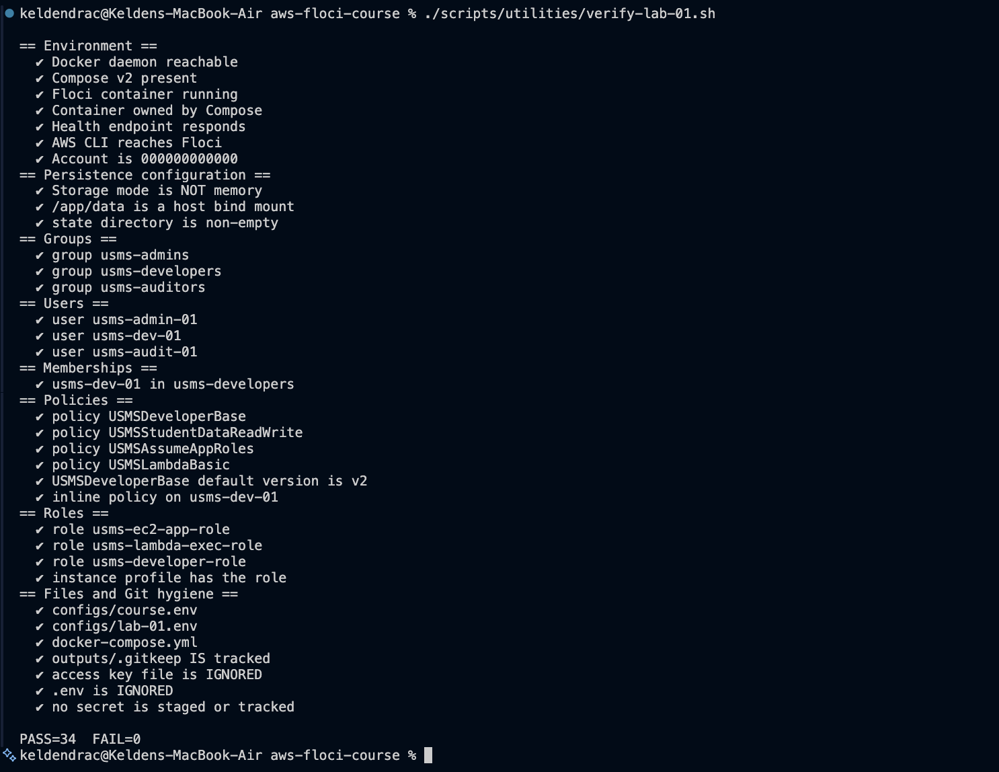
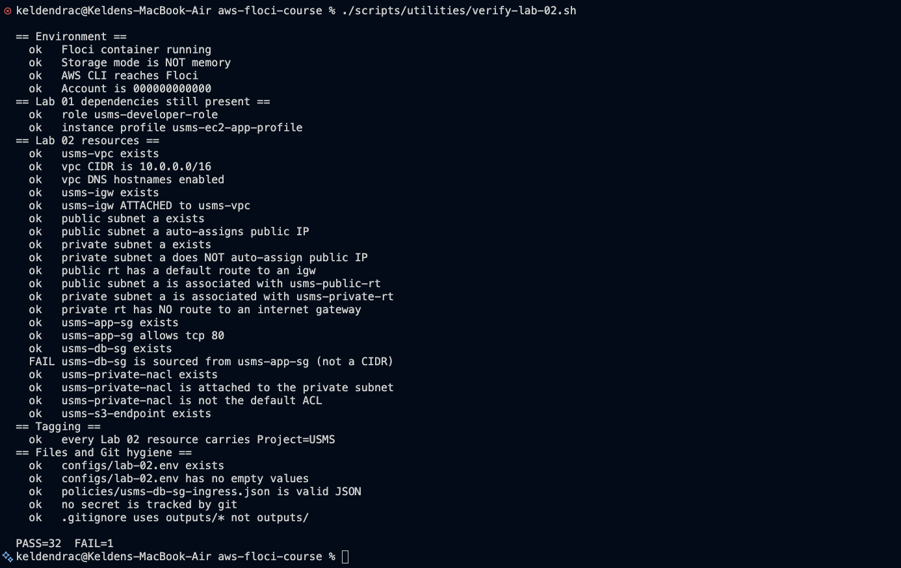
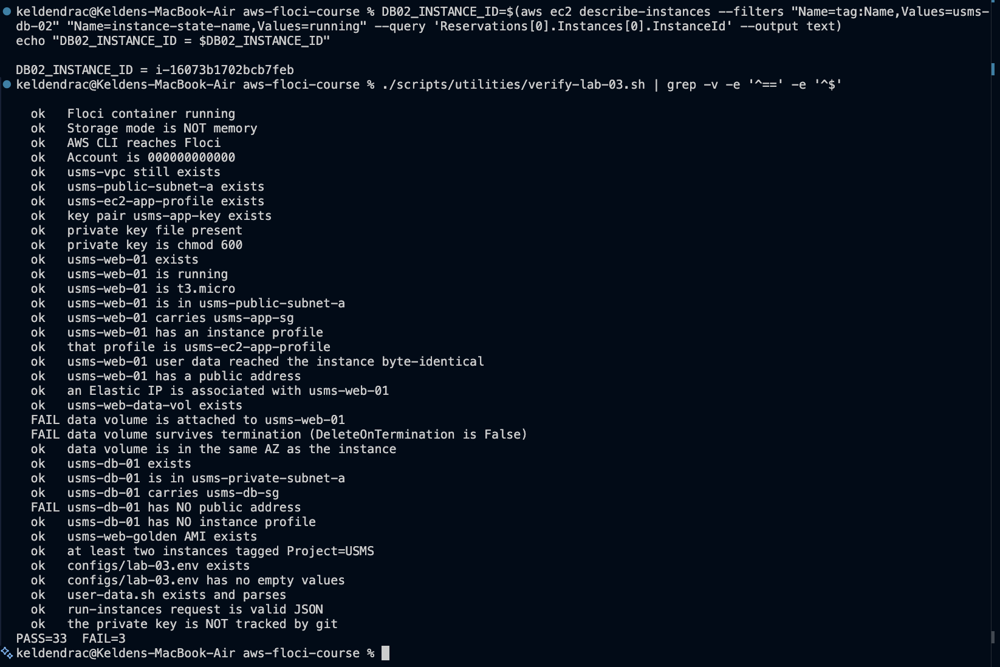
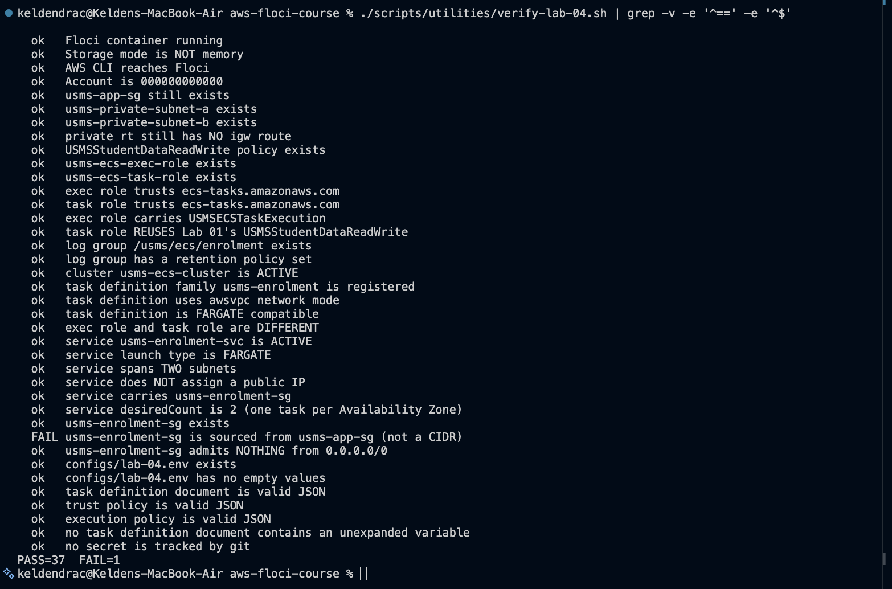
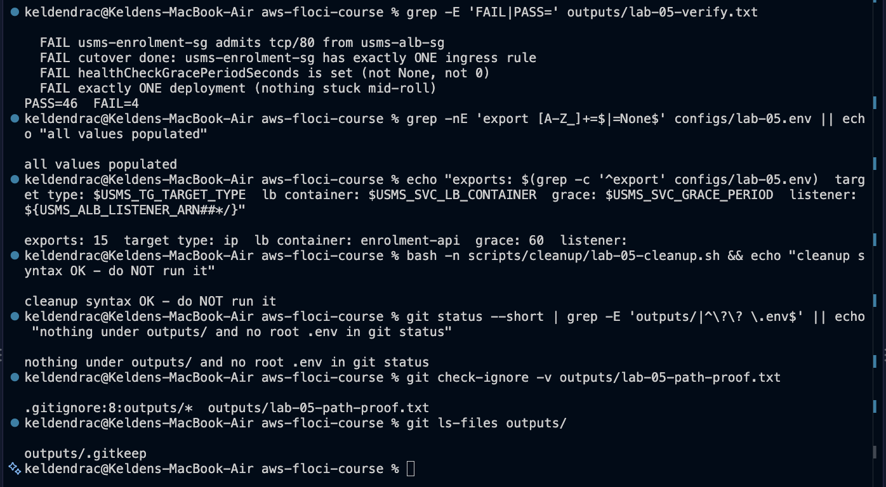
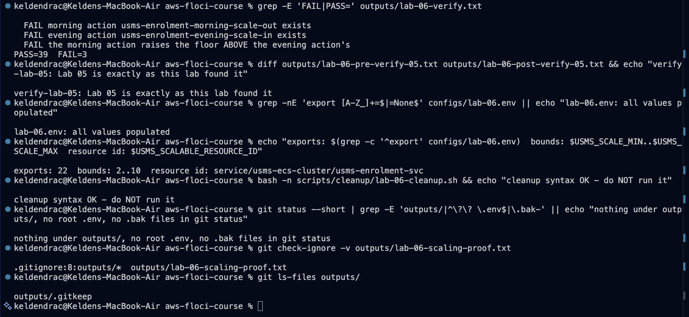
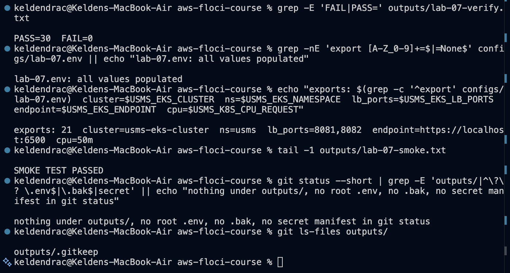
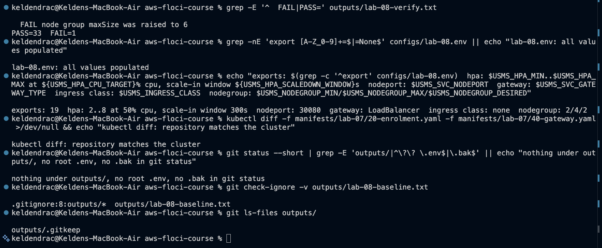
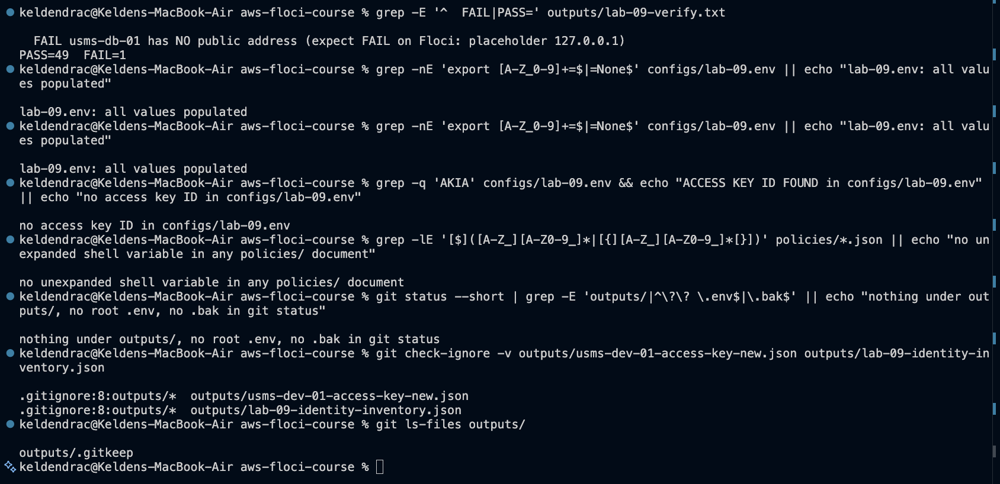

# AWS CLI + Floci - USMS Course Project

Infrastructure for the **University Student Management System (USMS)**, built lab by lab
with the AWS CLI against [Floci](https://floci.io), a local AWS emulator.

## Quick start

```bash
source configs/course.env
./scripts/setup/floci-up.sh
./scripts/utilities/whoami.sh
```

## Daily workflow

```bash
./scripts/setup/floci-up.sh      # start or resume (idempotent)
# ... lab work ...
./scripts/setup/floci-down.sh    # pause; state is kept
```

## Never run these

| Command | Why |
|---|---|
| `docker compose down -v` | `-v` deletes volumes |
| `docker volume prune` | Unfiltered; use scripts/cleanup/floci-prune-volumes.sh |
| `floci start ...` | Bypasses Compose; disables persistence |
| `rm -rf ~/floci-data` | That directory is the IAM state |

## Labs

| Lab | Topic | Status | Report |
|-----|-------|--------|--------|
| 01  | IAM   | [x] complete | [lab-01-report.md](labs/lab-01-iam/lab-01-report.md) |
| 02  | VPC   | [x] complete | [lab-02-report.md](labs/lab-02-vpc/lab-02-report.md) |
| 03  | EC2   | [x] complete | [lab-03-report.md](labs/lab-03-ec2/lab-03-report.md) |
| 04  | ECS   | [x] complete | [lab-04-report.md](labs/lab-04-ecs/lab-04-report.md) |
| 05  | ECS + ALB | [x] complete | [lab-05-report.md](labs/lab-05-ecs-alb/lab-05-report.md) |
| 06  | ECS Auto Scaling | [x] complete | [lab-06-report.md](labs/lab-06-ecs-autoscaling/lab-06-report.md) |
| 07  | EKS   | [x] complete | [lab-07-report.md](labs/lab-07-eks/lab-07-report.md) |
| 08  | EKS scaling and exposure | [x] complete | [lab-08-report.md](labs/lab-08-eks-scaling/lab-08-report.md) |
| 09  | Security review (IAM + security groups) | [x] complete | [lab-09-report.md](labs/lab-09-security/lab-09-report.md) |

### Lab 01 verification



Reproduce with:

```bash
source configs/course.env
./scripts/setup/floci-up.sh
source configs/lab-01.env
./scripts/utilities/verify-lab-01.sh
```

### Lab 02 verification



The one failure is a documented Floci limitation (group-to-group security
group rules are not persisted by this emulator build), not a build error -
see [lab-02-report.md](labs/lab-02-vpc/lab-02-report.md) Section 7.

Reproduce with:

```bash
source configs/course.env
./scripts/setup/floci-up.sh
source configs/lab-01.env
source configs/lab-02.env
./scripts/utilities/verify-lab-02.sh
```

### Lab 03 verification



The three failures are documented Floci limitations, not build errors: this
emulator build has no `AttachVolume` (two checks), and it gives every
instance the placeholder public address `127.0.0.1` (one check). See
[lab-03-report.md](labs/lab-03-ec2/lab-03-report.md) Sections 3.10 and 7.

Reproduce with:

```bash
source configs/course.env
./scripts/setup/floci-up.sh
source configs/lab-01.env
source configs/lab-02.env
source configs/lab-03.env
./scripts/utilities/verify-lab-03.sh
```

### Lab 04 verification



The one failure is the documented Floci limitation from Lab 02: the enrolment
security group's rule was written as a group reference to `usms-app-sg`, and
this emulator build does not store group references. This Floci build is on
support path B (ECS only): Application Auto Scaling is not implemented. See
[lab-04-report.md](labs/lab-04-ecs/lab-04-report.md) Sections 3.7 and 7.

Reproduce with:

```bash
source configs/course.env
./scripts/setup/floci-up.sh
source configs/lab-01.env
source configs/lab-02.env
source configs/lab-03.env
source configs/lab-04.env
./scripts/utilities/verify-lab-04.sh
```

Since Lab 05's Exercise 2, this script asserts the enrolment tasks' *current*
upstream group. That is `usms-alb-sg` when `configs/lab-05.env` exists, and
`usms-app-sg` otherwise. It now reports `PASS=38  FAIL=1` (39 checks), with
the same single Floci failure.

### Lab 05 verification



The four failures are documented Floci limitations, not build errors:
- group references in security group rules are not stored
- `revoke-security-group-ingress` returns `True` and removes nothing, so the
  Step 13 cutover could not take effect
- `healthCheckGracePeriodSeconds` is not stored
- the service's `deployments` list is always `null`

This build models ELBv2 fully and runs health checks and forwarding inside
the Docker network, but the load balancer's DNS name does not resolve from
the host. See [lab-05-report.md](labs/lab-05-ecs-alb/lab-05-report.md)
Sections 3.6, 3.7, 3.9 and 7.

Reproduce with:

```bash
source configs/course.env
./scripts/setup/floci-up.sh
source configs/lab-01.env
source configs/lab-02.env
source configs/lab-03.env
source configs/lab-04.env
source configs/lab-05.env
./scripts/utilities/verify-lab-05.sh
```

Since Lab 06 moved the emulator to Floci 2.2.0, this script reports
`PASS=48  FAIL=2`. The grace period and the `deployments` list are now
stored, and the two security group limitations remain.

### Lab 06 verification



Floci 1.5.34 has no Application Auto Scaling, so Lab 06 runs on **Floci
2.2.0**. `docker-compose.yml` is pinned to `floci/floci:2.2.0`, and the Lab
1-5 state was verified to load unchanged first. The scaling loop really runs
on 2.2.0: an alarm invoked the step policy and `desiredCount` went 2 -> 10,
with `Cause` strings naming the alarm and the policy.

The three failures are the scheduled-action checks: this build answers
`PutScheduledAction` with `UnsupportedOperation`. See
[lab-06-report.md](labs/lab-06-ecs-autoscaling/lab-06-report.md) Sections
3.1, 3.5, 3.6 and 7.

Reproduce with:

```bash
./scripts/setup/floci-up.sh
source configs/course.env
source configs/lab-01.env
source configs/lab-02.env
source configs/lab-03.env
source configs/lab-04.env
source configs/lab-05.env
source configs/lab-06.env
./scripts/utilities/verify-lab-06.sh
```

### Lab 07 verification



Lab 07 runs on support path A. `aws eks create-cluster` starts a real k3s
1.30 cluster on `https://localhost:6500`, so Deployments, DNS discovery,
rollouts and the failure drills really run. The managed node group is a
record only, and every pod runs on the single k3s server node. `kubectl`
authenticates as `usms-developer-role` through an EKS access entry. That
needs `authenticationMode=API_AND_CONFIG_MAP` at cluster creation, which
the request template sets. See
[lab-07-report.md](labs/lab-07-eks/lab-07-report.md) Sections 3.3, 3.4,
6 and 7.

Reproduce with:

```bash
./scripts/setup/floci-up.sh
source configs/course.env
source configs/lab-01.env
source configs/lab-02.env
source configs/lab-03.env
source configs/lab-04.env
source configs/lab-05.env
source configs/lab-06.env
source configs/lab-07.env
aws eks wait cluster-active --name usms-eks-cluster && ./scripts/utilities/wait-kube.sh 300
./scripts/utilities/verify-lab-07.sh
```

Since Lab 08, enrolment and results are owned by HPAs (minimum 2), and
Exercise 2 runs the gateway at 2 replicas. The script therefore checks "at
least 2" for enrolment and results, and "as many as `40-gateway.yaml`
declares" for the gateway. It still reports `PASS=30  FAIL=0`.

### Lab 08 verification



Lab 08 runs on support path A. The HPA scaled `usms-enrolment` 2 -> 3 under
real load and back after its 300 s window. k3s ServiceLB gave the gateway a
real `LoadBalancer` address, reachable inside the cluster.

The one failure is "node group maxSize was raised to 6". Floci 2.2.0 answers
`UpdateNodegroupConfig` with `UnknownOperationException`. This build also
ignores the `_lb_ports_` tag and runs no ingress controller. See
[lab-08-report.md](labs/lab-08-eks-scaling/lab-08-report.md) Sections 3.1,
3.5, 3.6 and 7.

Reproduce with:

```bash
./scripts/setup/floci-up.sh
source configs/course.env
source configs/lab-01.env
source configs/lab-02.env
source configs/lab-04.env
source configs/lab-07.env
source configs/lab-08.env
aws eks wait cluster-active --name usms-eks-cluster && ./scripts/utilities/wait-kube.sh 300
./scripts/utilities/verify-lab-08.sh
```

### Lab 09 verification



Lab 09 runs on support path A. The IAM simulator evaluates conditions and
permissions boundaries, so the scoped `iam:PassRole` and the boundary on
`usms-deploy-role` are shown with IAM's own decisions. Nothing is enforced
on real calls, and security groups carry no traffic.

The one failure is `usms-db-01 has NO public address`: Floci gives every
instance the placeholder address `127.0.0.1`.

Before its baseline, Lab 09 repaired `usms-db-sg` and `usms-enrolment-sg`.
Floci 1.5.34 had kept their group-referenced rules with no source, and they
were re-applied from the committed documents. As a result,
`verify-lab-02.sh` and `verify-lab-04.sh` now report `FAIL=0`. See
[lab-09-report.md](labs/lab-09-security/lab-09-report.md) Sections 3.1,
3.7 and 6.

Reproduce with:

```bash
./scripts/setup/floci-up.sh
source configs/course.env
source configs/lab-01.env
source configs/lab-02.env
source configs/lab-03.env
source configs/lab-04.env
source configs/lab-05.env
source configs/lab-06.env
source configs/lab-09.env
./scripts/utilities/verify-lab-09.sh
```

## Conventions

- All resources are prefixed `usms-`
- Region: `us-east-1`  ·  Floci account: `000000000000`
- Storage mode: `hybrid`, bind-mounted to `~/floci-data`
- Secrets live in `outputs/` and are **never** committed
