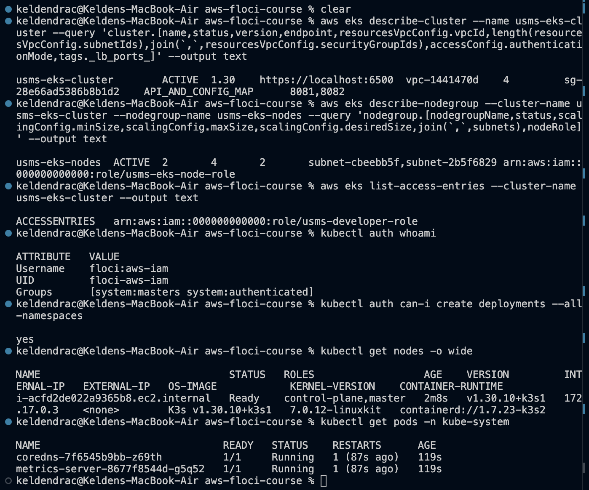
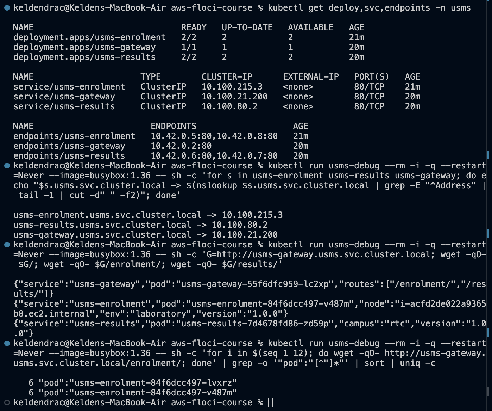
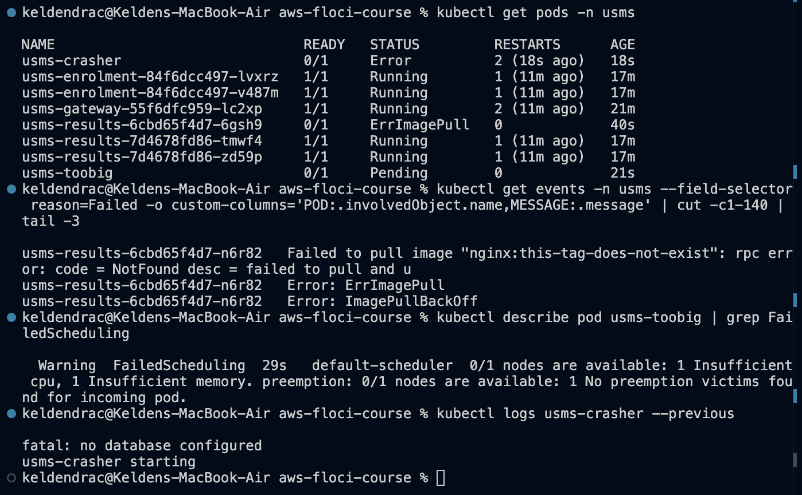
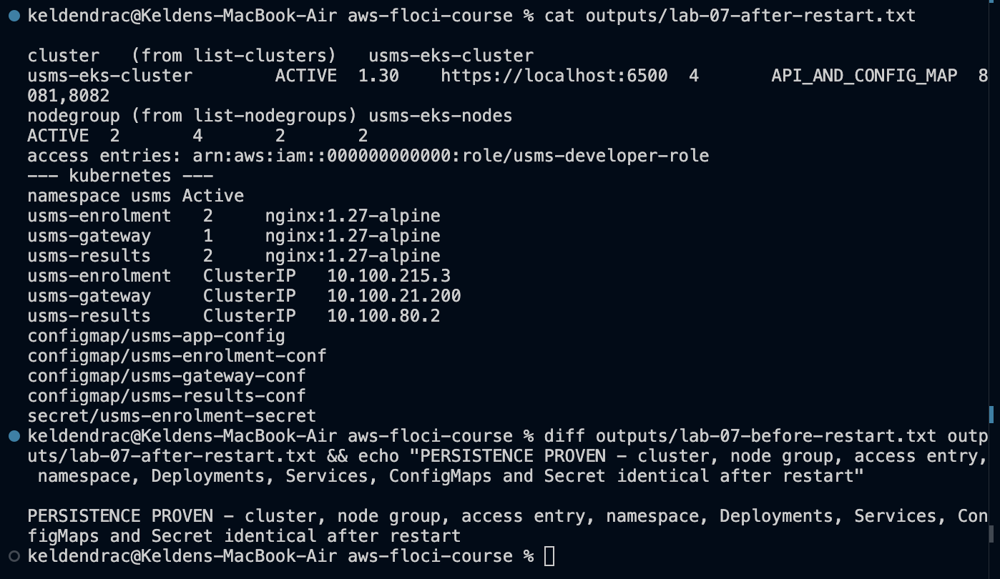

# Lab 07 - Microservices on Amazon EKS - completed

Full write-up: [lab-07-report.md](lab-07-report.md) - exercises: [exercises.md](exercises.md) - review questions: [../../notes/lab-07-notes.md](../../notes/lab-07-notes.md)

**Support path: A, on Floci 2.2.0.** `aws eks create-cluster` starts a real
k3s 1.30 cluster with its API on `https://localhost:6500`, so the
Kubernetes half of this lab really runs. The managed node group is stored
as a record only; every pod runs on the single k3s server node.

## What exists after this lab

- **IAM:**
  - `usms-eks-cluster-role` (trusts `eks.amazonaws.com`) ->
    `USMSEKSClusterPolicy`
  - `usms-eks-node-role` (trusts `ec2.amazonaws.com`) -> `USMSEKSNodePolicy`
    and Lab 01's `USMSStudentDataReadWrite`
  - the OIDC provider for the cluster's issuer
- **Network:** `usms-eks-cluster-sg` in `usms-vpc`, tcp/443 from
  `10.0.0.0/16`
- **EKS:**
  - `usms-eks-cluster` `ACTIVE`, 1.30, four subnets, `API_AND_CONFIG_MAP`,
    tag `_lb_ports_=8081,8082`
  - access entry `usms-developer-role` -> `system:masters`
  - `usms-eks-nodes` 2/4/2 in the private subnets
- **Namespace `usms`:**
  - Deployments `usms-gateway` (1), `usms-enrolment` (2, `maxUnavailable 0`,
    CPU request `50m`), `usms-results` (2), `usms-timetable` (1), each with
    a ClusterIP Service
  - ConfigMaps `usms-app-config` and one `-conf` per service
  - Secret `usms-enrolment-secret`, ServiceAccount `usms-enrolment-sa`, PDB
    `usms-enrolment-pdb`
- **Kubeconfig:** context `usms-eks` in `~/.kube/config` (outside the repo),
  authenticating as `usms-developer-role` through `--role-arn`
- **Config:** `configs/lab-07.env`, 21 exports
- **Manifests:** `manifests/lab-07/` `00` `10` `20` `21` `30` `40` `60` `70`.
  The Secret manifest is in `outputs/` (git-ignored), not here
- **Policies and templates:** `policies/trust-eks-{cluster,node}.json`,
  `policies/usms-eks-{cluster,node}-policy.json`,
  `templates/lab-07-create-{cluster,nodegroup}.json`
- **Scripts** (cleanup never run):
  - `scripts/utilities/`: `eks-support-probe.sh`,
    `write-lab-07-requests.sh`, `wait-pod-state.sh`, `wait-kube.sh`,
    `lab-07-restart-facts.sh`, `write-lab-07-env.sh`, `verify-lab-07.sh`,
    `lab-07-exercise-edits.py`
  - `labs/lab-07-eks/`: `lab07-readiness.sh` (Exercise 5),
    `failure-toobig.yaml`, `failure-crasher.yaml`, `exercise3-broken.yaml`
  - `scripts/cleanup/lab-07-cleanup.sh`
- **Unchanged:** the Lab 04-06 ECS service, still 2/2 behind the Lab 05 ALB

## Reproduce

    cd ~/Desktop/aws-floci-course
    ./scripts/setup/floci-up.sh
    source configs/course.env
    source configs/lab-01.env
    source configs/lab-02.env
    source configs/lab-03.env
    source configs/lab-04.env
    source configs/lab-05.env
    source configs/lab-06.env
    source configs/lab-07.env
    aws eks wait cluster-active --name usms-eks-cluster && ./scripts/utilities/wait-kube.sh 300
    ./scripts/utilities/verify-lab-07.sh

Expected: `PASS=30  FAIL=0`.

## Evidence

### 1. Checkpoint 3 - cluster, node group and access

### 2. Checkpoint 5 - service discovery from inside the cluster

### 3. Checkpoint 7 - three failures, each diagnosed

### 4. Checkpoint 8 - persistence

### 5. verify-lab-07.sh and hygiene

## Problems I hit and how I fixed them

### 1. `kubectl` could not log in to the guide's cluster

On probe clusters, the guide's `create-cluster` body gave a `CONFIG_MAP`-mode
cluster. Floci ignores `aws-auth` in that mode and refuses access entries, so
every `kubectl` call failed with `You must be logged in to the server`.
`update-cluster-config` is not implemented, so the mode cannot be changed
later, and the guide's fallback needs `k3d`, which is not installed.

The fix has three parts:
- `accessConfig.authenticationMode=API_AND_CONFIG_MAP` in the request body
- an access entry mapping `usms-developer-role` to `system:masters`
- `update-kubeconfig --role-arn` with that role

### 2. The first build ran with empty variables

Stages 2-4 first ran in a terminal without the env files. Floci accepted
every result:
- a security group in `vpc-default` with a `None` CIDR
- a cluster with `securityGroupIds: ["None"]`
- no access entry
- a kubeconfig with `--role ""`

I deleted the node group, cluster, k3s volume, stray SG and context, kept
the IAM objects, and rebuilt behind the `READY` guard.
`write-lab-07-requests.sh` now refuses to write a body containing an empty
or `None` value.

### 3. Creating the node group recreates the cluster

Floci replaces the k3s container to "apply current node capacity limits",
and the cluster goes back to `CREATING`. `wait nodegroup-active` returns
first, so a second `wait cluster-active` is chained before
`update-kubeconfig`.

### 4. `create-cluster` blocks until k3s is up

The CLI's 60 s read timeout fired, and its retry failed with
`ResourceInUseException` against the cluster the first attempt made.
`--cli-read-timeout 300` fixes it.

### 5. Waiting on pod states

`kubectl wait -l` matches the old, healthy pods during a rollout, so it
cannot wait for "some pod reached `ImagePullBackOff`". `wait-pod-state.sh`
polls for the state instead, and `wait-kube.sh` waits for `/readyz` and the
rollouts after a restart. No `sleep` anywhere.

### 6. The guide's verify and env checks, again

- The `.gitkeep` fix to "no secret is tracked by git", as in Labs 04-06.
- `grep -E` for the empty-value check, because BSD `grep` treats `\|`
  literally.
- `kubectl get --raw /readyz` as the API check.

### 7. IRSA stops at the webhook

The issuer is filled in, and the IAM OIDC provider registers. But Floci
turns Pod Identity injection off without TLS, so a pod using
`usms-enrolment-sa` gets no token and no `AWS_*` variables. The pods' AWS
permissions are still the node role's. This is recorded, not claimed as
done.
