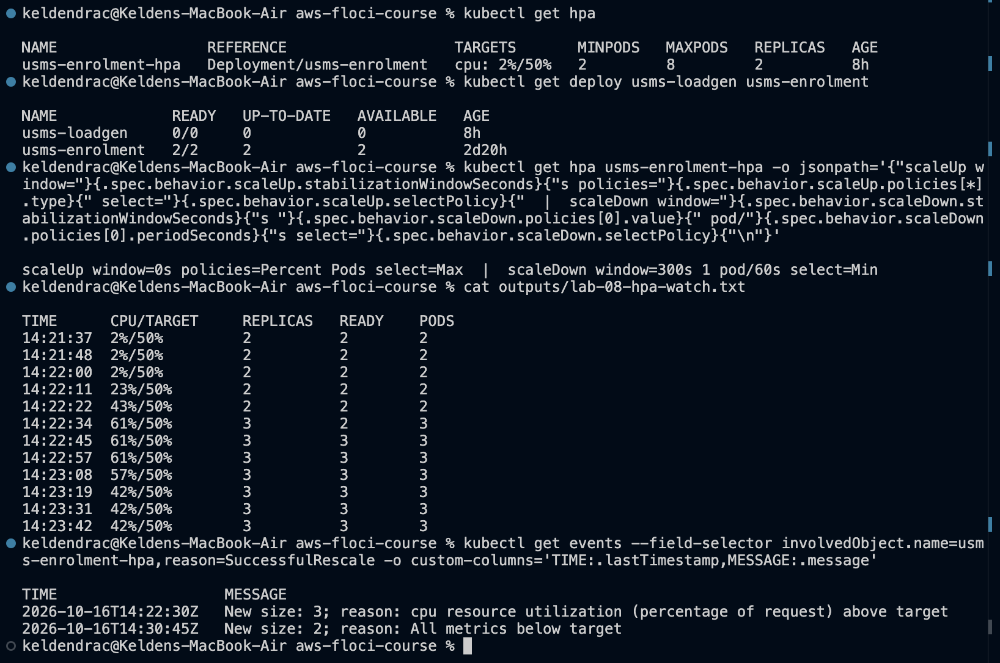
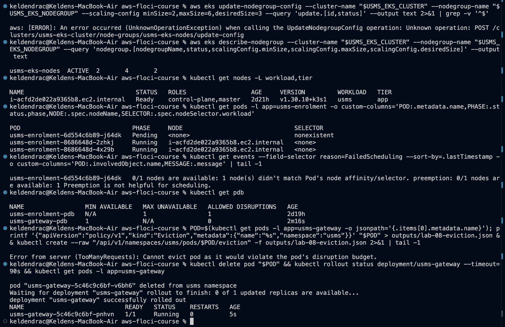
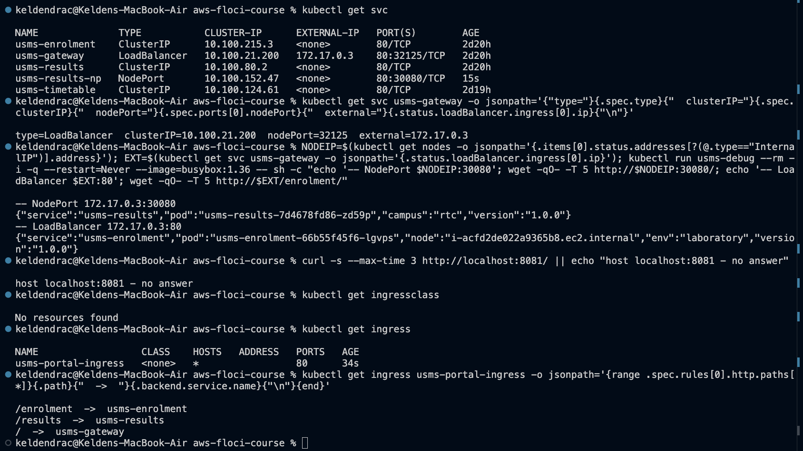
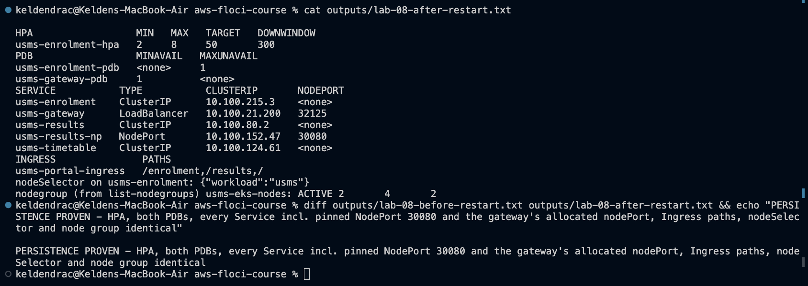

# Lab 08 - EKS scaling and service exposure - completed

Full write-up: [lab-08-report.md](lab-08-report.md) - exercises: [exercises.md](exercises.md) - review questions: [../../notes/lab-08-notes.md](../../notes/lab-08-notes.md)

**Support path: A, on Floci 2.2.0.** The Kubernetes half really runs:
- the HPA scaled `usms-enrolment` 2 -> 3 under load, and back to 2 after its
  300 s window
- k3s ServiceLB gave the gateway a real `LoadBalancer` address

The AWS half has three gaps on this build:
- `update-nodegroup-config` does not exist
- the `_lb_ports_` tag is ignored
- there is no ingress controller

## What exists after this lab

- **HPAs:**
  - `usms-enrolment-hpa`: 2-8, CPU 50% of the 50m request; scale-up instant
    and rate-limited; scale-in after 300 s, one pod per minute
  - `usms-results-hpa`: 2-6, 60% (Exercise 1)
- **PDBs:**
  - `usms-gateway-pdb`: `minAvailable 1`
  - `usms-enrolment-pdb`: `maxUnavailable 1`, redefined from Lab 07
- **Scheduling:** `nodeSelector workload=usms` on `usms-enrolment`; the node
  labelled `workload=usms tier=app` by hand
- **Exposure:**
  - `usms-results-np`: NodePort `80:30080`
  - `usms-gateway`: `LoadBalancer`, nodePort 32125, external `172.17.0.3`
  - `usms-portal-ingress`: `/enrolment`, `/results`, `/`
  - `usms-results-ingress`: `/examinations/results`, source-IP restricted,
    same IngressGroup (Exercise 4)
- **Workloads:** `usms-gateway` at 2 replicas (Exercise 2); `usms-loadgen`
  deleted
- **Node group:** `usms-eks-nodes` unchanged at 2/4/2. The 2/6/3 update is
  `UnknownOperationException`
- **Config:** `configs/lab-08.env`, 19 exports
- **Manifests:** `manifests/lab-08/` `10` `11` `20` `30` `40` `50` `60` `61`
- **Lab 07 manifests changed:**
  - `20-enrolment.yaml`: `nodeSelector` added
  - `40-gateway.yaml`: Service block moved to `50`, and `replicas: 2`
  - `21-enrolment-pdb.yaml`: removed (its object is now in `30`)
- **Scripts** (cleanup never run):
  - `scripts/utilities/`: `hpa-watch.sh`, `wait-hpa.sh`, `lab-08-edits.py`,
    `lab-08-restart-facts.sh`, `write-lab-08-env.sh`, `verify-lab-08.sh`;
    `verify-lab-07.sh` updated
  - `labs/lab-08-eks-scaling/`: `lab08-readiness.sh` (Exercise 5),
    `exercise3-broken.yaml`
  - `scripts/cleanup/lab-08-cleanup.sh`

## Reproduce

    cd ~/Desktop/aws-floci-course
    ./scripts/setup/floci-up.sh
    source configs/course.env
    source configs/lab-01.env
    source configs/lab-02.env
    source configs/lab-04.env
    source configs/lab-07.env
    source configs/lab-08.env
    aws eks wait cluster-active --name usms-eks-cluster && ./scripts/utilities/wait-kube.sh 300
    ./scripts/utilities/verify-lab-08.sh

Expected: `PASS=33  FAIL=1`. The failure is "node group maxSize was raised
to 6".

## Evidence

### 1. Checkpoint 3 - the HPA moving

### 2. Checkpoint 4 - node group, nodeSelector and PDBs

### 3. Checkpoints 5-6 - the exposure ladder

### 4. Checkpoint 7 - persistence

### 5. verify-lab-08.sh and hygiene

## Problems I hit and how I fixed them

### 1. `update-nodegroup-config` does not exist

Both it and `list-updates` return `UnknownOperationException` on Floci
2.2.0. Recreating the node group would satisfy verify, but on Floci a node
group change replaces the k3s container, which would put the running
application at risk for a node that never appears. So 2/4/2 stays, and
verify's one failure is explained.

### 2. The HPA's evidence expired

k3s keeps events for one hour. The first Checkpoint 3 capture, taken hours
after the run, showed no rescale events, only an unrelated `FailedGetScale
Unauthorized` warning from while the cluster sat idle. I re-ran the load and
captured it within the hour. The command now filters on
`reason=SuccessfulRescale`.

### 3. A terminal without the env, and skipped setup

The first Checkpoint 4 capture had `$USMS_EKS_CLUSTER` empty (URL
`/clusters/node-groups/...`) and no gateway PDB, so the eviction
**succeeded**. I retook it behind the `READY` guard, with the setup blocks.

### 4. The node group's labels never reached the node

Kubelet `--node-labels` apply only when a node first registers, and this
node predates the node group. The `nodeSelector` rollout stalled, harmlessly
thanks to `maxUnavailable: 0`, until I labelled the node by hand.

### 5. Two files owning one object

The gateway Service was in both `40-gateway.yaml` (ClusterIP) and
`50-service-loadbalancer.yaml`. The enrolment PDB was in both
`21-enrolment-pdb.yaml` and `30-pdb-gateway.yaml`. `lab-08-edits.py` gives
each object a single owner, and `kubectl diff` is clean on both.

### 6. The guide's own commands, adjusted

- **The Step 11 Python anchor is gone** since Lab 07 Exercise 4.
  `lab-08-edits.py nodeselector` replaces it.
- **`sleep` became deterministic waits:** `wait-hpa.sh`, `kubectl wait
  --for=jsonpath`, `wait-kube.sh`.
- **verify:** the `.gitkeep` fix, and `/readyz` as the API check.
- **`kubectl port-forward &` dies with `Broken pipe`** under the exec-plugin
  kubeconfig. `</dev/null` fixes it.

### 7. Exercise 3's first fault behaves differently here

A container with a limit and no request has the limit copied into its
request at admission. The HPA computed against 200m, `Guaranteed`, rather
than reporting `<unknown>`. The fault is real (the wrong denominator, and
800m reserved), and the diagnosis records what was actually observed.
