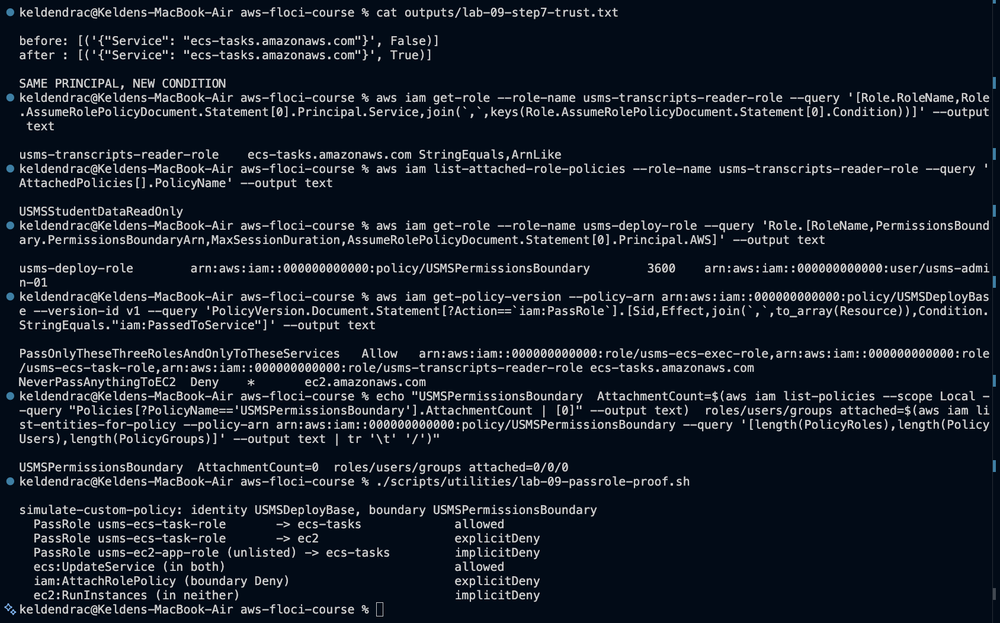
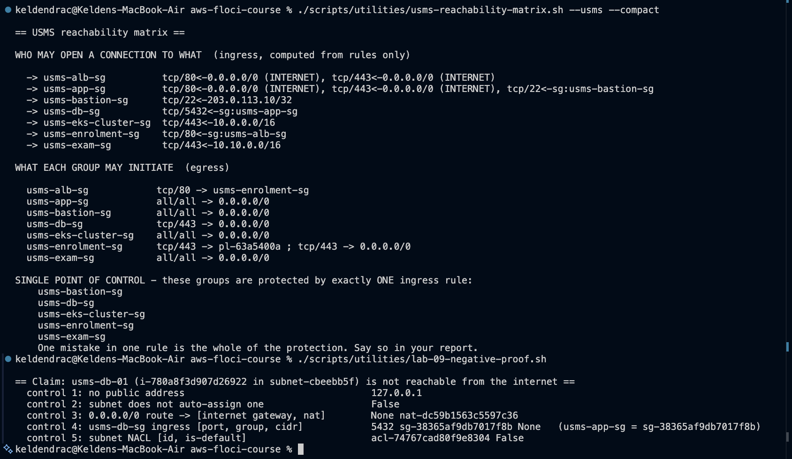
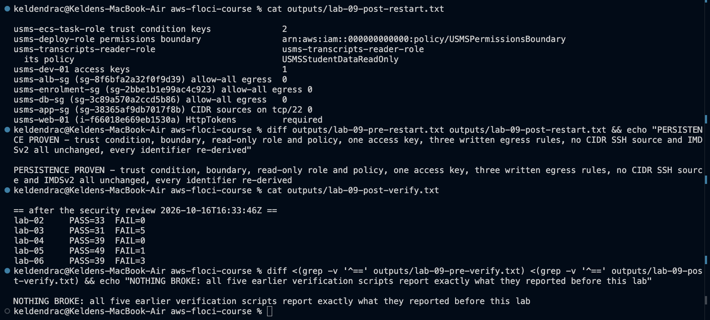

# Lab 09 - Securing USMS with IAM roles and security groups - completed

Full write-up: [lab-09-report.md](lab-09-report.md) - exercises: [exercises.md](exercises.md) - review questions: [../../notes/lab-09-notes.md](../../notes/lab-09-notes.md)

**Support path: A, on Floci 2.2.0.** The IAM simulator really evaluates
conditions and permissions boundaries, so the PassRole scope and the
boundary are shown with IAM's own decisions. Nothing is enforced on real
calls, and security groups carry no traffic, so every network claim is a
claim about rules, read back.

## What exists after this lab

- **Policies:**
  - `USMSStudentDataReadOnly`: Get + List, explicit Deny on every write
  - `USMSDeployBase`: `iam:PassRole` limited to three named roles, to ECS
    tasks only, with a Deny on passing anything to EC2
  - `USMSPermissionsBoundary`: a ceiling; attached to nothing, used only
    as a boundary. Do not tidy it up
  - `USMSBreakGlassSuspendScaling` (Exercise 2)
- **Roles:**
  - `usms-transcripts-reader-role` (scoped `ecs-tasks` trust)
  - `usms-deploy-role` (trusts `usms-admin-01`, wears the boundary)
  - `usms-breakglass-role` (MFA + ExternalId, 3600 s, boundary; Exercise 2)
- **Trust policies with confused-deputy conditions, same principals:**
  - `usms-ecs-task-role` (Step 7)
  - `usms-ecs-exec-role` and `usms-lambda-exec-role` (Exercise 2)
- **Credentials:** `usms-dev-01` has one access key, created 2026-10-16;
  the Lab 01 key is deleted and the `usms-dev` profile repointed
- **Instances:** IMDSv2 required with hop limit 1 on `usms-web-01`; the
  metadata endpoint disabled on `usms-db-01`
- **Security groups:**
  - written egress on `usms-alb-sg` (tcp/80 to `usms-enrolment-sg`),
    `usms-enrolment-sg` (tcp/443), `usms-db-sg` (tcp/443) and `usms-app-sg`
    (Exercise 1); no allow-all default left on any of them
  - `usms-app-sg` tcp/22 from `usms-bastion-sg`
  - `usms-db-sg` and `usms-enrolment-sg` ingress repaired from their
    committed documents before the baseline
- **Config:** `configs/lab-09.env` (17 exports, no access key ID);
  `configs/usms-iam-accepted-findings.tsv` (the audit's decision record)
- **Policies directory:** 15 new documents, including
  `usms-egress-allow-all.json`, the undo
- **Scripts** (cleanup never run):
  - `scripts/utilities/`: `lab-09-probe.sh`, `usms-identity-inventory.sh`,
    `usms-iam-audit.sh`, `usms-sg-audit.sh`, `usms-reachability-matrix.sh`,
    `write-lab-09-policies.sh`, `lab-09-compare.py`,
    `lab-09-passrole-proof.sh`, `lab-09-negative-proof.sh`,
    `lab-09-restart-facts.sh`, `write-lab-09-env.sh`, `verify-lab-09.sh`,
    `usms-exposure-report.sh`, `usms-bucket-policy-draft.sh`
  - `scripts/cleanup/lab-09-cleanup.sh`
- **Unchanged, deliberately:** the ECS service, task definition, load
  balancer, scaling, and `USMSStudentDataReadWrite` on its three roles

## Reproduce

    cd ~/Desktop/aws-floci-course
    ./scripts/setup/floci-up.sh
    source configs/course.env
    source configs/lab-01.env
    source configs/lab-02.env
    source configs/lab-03.env
    source configs/lab-04.env
    source configs/lab-05.env
    source configs/lab-06.env
    source configs/lab-09.env
    ./scripts/utilities/verify-lab-09.sh

Expected: `PASS=49  FAIL=1`. The one failure is `usms-db-01 has NO public
address`: Floci gives every instance the placeholder `127.0.0.1`.

## Evidence

### 1. Checkpoints 3-4 - identity

### 2. Checkpoints 8-10 - network

### 3. Checkpoint 11 - persistence and regression

### 4. verify-lab-09.sh and hygiene

## Problems I hit and how I fixed them

### 1. The earlier labs' group-referenced rules had no source

Floci 1.5.34 stored `usms-db-sg`'s and `usms-enrolment-sg`'s group
references as rules with no source. I cleared them and re-applied the
committed documents before the baseline. `verify-lab-02` and
`verify-lab-04` went to `FAIL=0`.

Two Floci behaviours shaped the order:
- a sourceless revoke matches every rule on the port
- `describe-security-group-rules` is a second store that revoke never
  updates, so every Lab 09 script reads `describe-security-groups`

### 2. Three of the guide's checks could not work

- ``IpProtocol==`-1` `` compares to the **number** -1, so the allow-all
  count is always 0. A verify built on it passes with nothing done.
- The boundary check's `\\\"...\\\"` quoting never matches.
- "No unexpanded variable" would fail on Lab 01's legitimate
  `${aws:username}`.

All three are fixed and explained in `verify-lab-09.sh`'s header.

### 3. Revoking by rule ID removes nothing on Floci 2.2.0

It returns `True` regardless. Step 16 and the cleanup script revoke by
`--ip-permissions`, naming the exact CIDR.

### 4. Credentials on Floci

An `Inactive` key still authenticates, and a **deleted** key silently
becomes root. The rotation's order (move, verify, deactivate, verify,
delete) was the only thing keeping the profile on the right identity.

### 5. The simulator and the shell

- `simulate-custom-policy --policy-input-list file://...` evaluates nothing;
  documents are passed inline.
- macOS bash 3.2 rejects an empty array under `set -u`.
- zsh history expansion is avoided with single-quoted `jq` instead of
  JMESPath `!=`.

### 6. Findings for the review (Exercise 4)

- **`usms-audit-01` can read every transcript** through the AWS managed
  `ReadOnlyAccess`.
- **Every EKS pod can write transcripts** through the node role.
- The web server is a second public entry point.

The Exercise 5 bucket policy draft computes **eight** roles with S3 access,
not the three the guide assumes.
