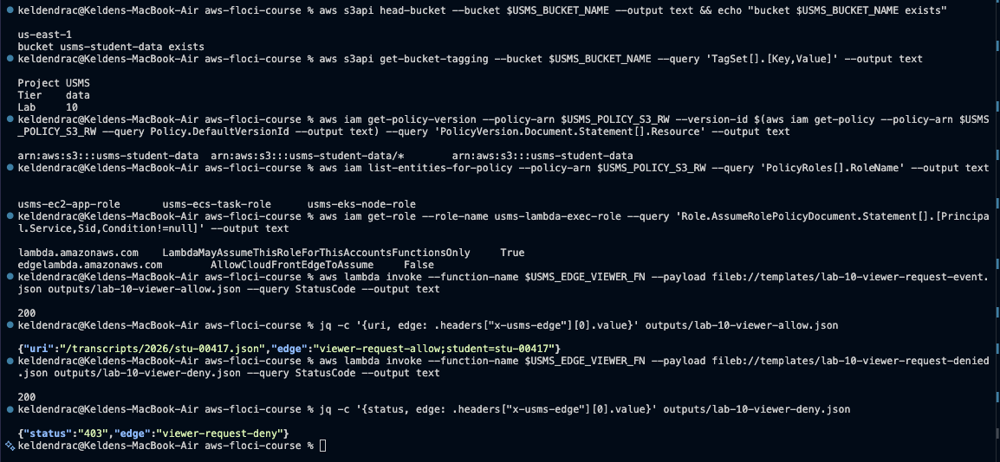
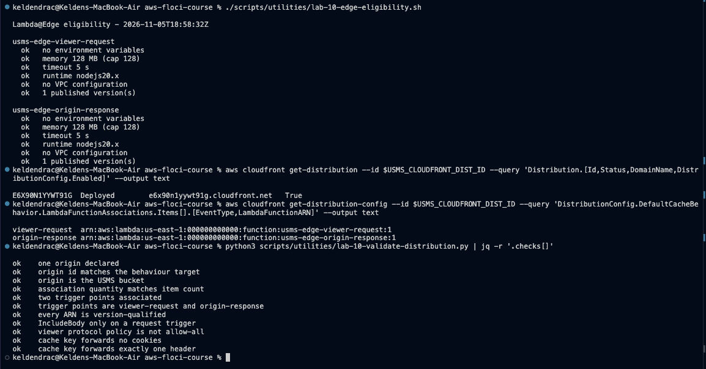
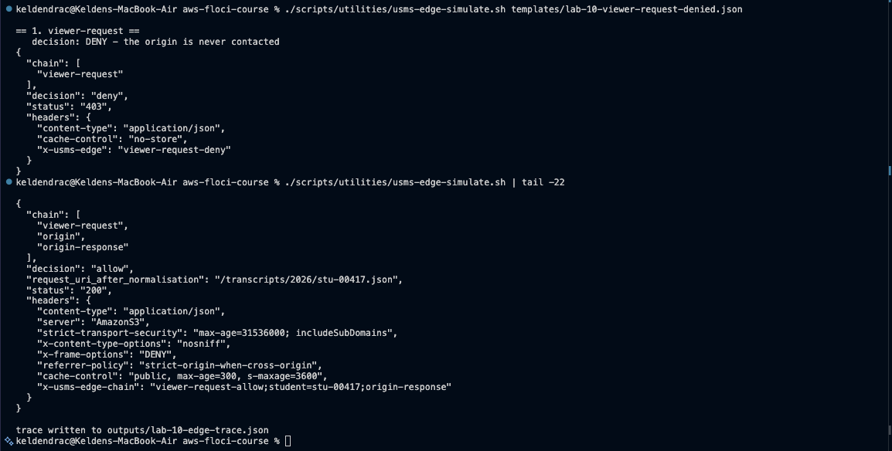
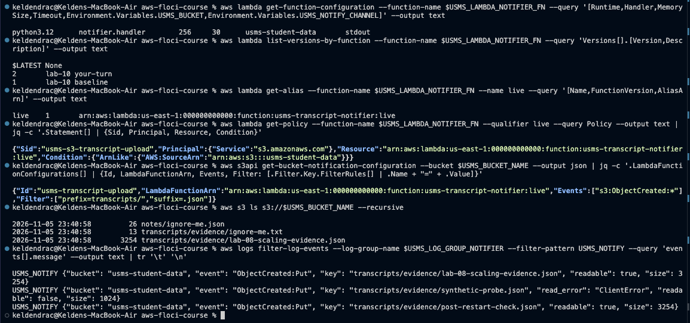
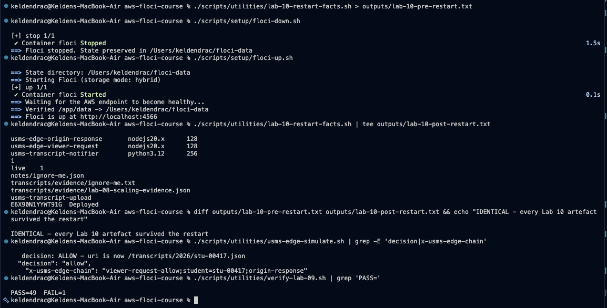
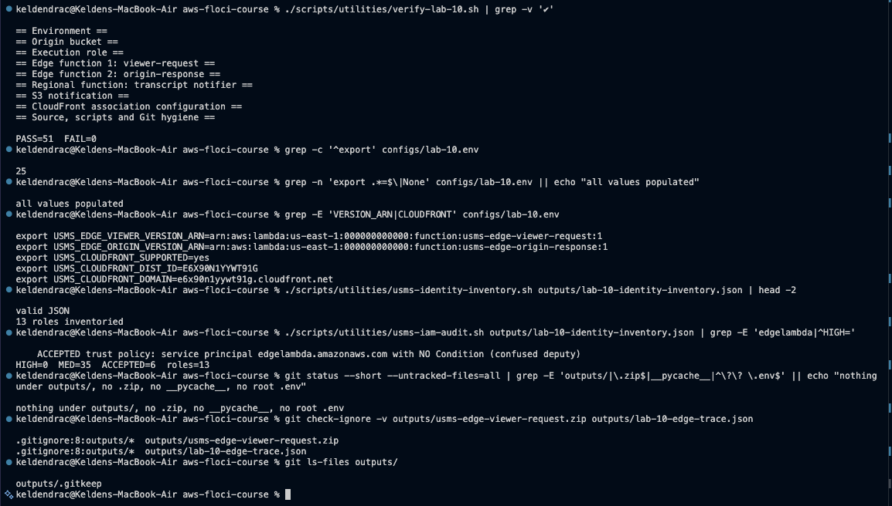

# Lab 10 - Edge functions with AWS Lambda - completed

Full write-up: [lab-10-report.md](lab-10-report.md) - exercises: [exercises.md](exercises.md) - review questions: [../../notes/lab-10-notes.md](../../notes/lab-10-notes.md) - design (Exercise 4): [../../notes/lab-10-edge-design.md](../../notes/lab-10-edge-design.md)

**Support path: A, on Floci 2.2.0.**
- **What runs:** Lambda executes real code, and S3 notifications are really delivered.
- **What is only a record:** a CloudFront distribution exists with both edge functions
  associated, but Floci never runs an associated function. A request to the
  distribution goes straight to S3.
- **What stands in:** `usms-edge-simulate.sh` runs the chain in CloudFront's order, and
  is the evidence that the two functions compose.

## What exists after this lab

- **Bucket** `usms-student-data`:
  - tagged `Project=USMS`, `Tier=data`, `Lab=10`
  - `USMSStudentDataReadWrite` finally resolves to it
  - notification `usms-transcript-upload` (`transcripts/*.json`) -> the notifier's `live`
    alias
- **Edge functions** (Node.js 20, 128 MB, 5 s, no environment variables):
  - `usms-edge-viewer-request`: auth gate and URI normalisation; versions 1-2
  - `usms-edge-origin-response`: security headers, transcript cache policy, chain
    marker; versions 1-3 (CSP from version 2, Exercise 1)
- **Regional function** `usms-transcript-notifier` (Python 3.12, with environment
  variables):
  - versions 1-2, alias `live` -> 1
  - resource policy for `s3.amazonaws.com`, scoped by `AWS:SourceArn`
- **CloudFront** `E6X90N1YYWT91G`: `Deployed`, associations `viewer-request:2`,
  `origin-response:3`
- **IAM:**
  - `usms-lambda-exec-role` trusts `lambda` (Lab 09 conditions kept) **and**
    `edgelambda`, as two statements
  - `usms-edge-exec-role` + `USMSEdgeBasic`: log writes only (Exercise 2)
  - two accepted audit findings, with reasons
- **`docker-compose.yml`:** two Lambda network settings. Without them no function runs
  on this repository's Docker networks (report Section 6.1)
- **Config:** `configs/lab-10.env` (25 exports, all looked up)
- **Scripts** (cleanup never run):
  - `scripts/utilities/`: `write-lab-10-templates.sh`, `lab-10-edge-eligibility.sh`,
    `lab-10-validate-distribution.py`, `usms-edge-simulate.sh`,
    `lab-10-restart-facts.sh`, `write-lab-10-env.sh`, `verify-lab-10.sh`,
    `usms-edge-report.sh`, `lab-10-s3-readiness.sh`
  - `scripts/cleanup/lab-10-cleanup.sh`

## Reproduce

    cd ~/Desktop/aws-floci-course
    ./scripts/setup/floci-up.sh
    source configs/course.env
    source configs/lab-01.env
    source configs/lab-10.env
    ./scripts/utilities/verify-lab-10.sh

Expected: `PASS=51  FAIL=0`.

## Evidence

### 1. Checkpoints 1-3 - bucket, role, viewer function

### 2. Checkpoints 4-6 - eligibility and the distribution

### 3. Checkpoint 7 - the edge chain

### 4. Checkpoints 8-9 - notifier, resource policy, notification

### 5. Checkpoint 10 - persistence

### 6. verify-lab-10.sh and hygiene

## Problems I hit and how I fixed them

### 1. No Lambda function ran

**The symptom.** "Failed to get next invocation" in every runtime container.

**The cause.** Since Lab 05, Floci also sits on the `usms-vpc` Docker network
(`10.0.0.2`) and advertised that address to Lambda containers, which cannot reach it.

**The fix.** Pinned it with `FLOCI_SERVICES_LAMBDA_DOCKER_HOST_OVERRIDE: floci` and
`FLOCI_SERVICES_LAMBDA_DOCKER_NETWORK: floci-course_default` in `docker-compose.yml`.

### 2. The guide's Step 6 would have undone Lab 09

Its one-statement trust drops the `aws:SourceAccount` / `aws:SourceArn` conditions on
`lambda.amazonaws.com`. I used two statements instead, and recorded the unconditioned
`edgelambda` statement as an accepted audit finding with its reasons.

### 3. Floci serves the distribution but runs no edge function

A request with no auth header got `200` and the object. The simulator, the eligibility
check, the structural validator and `verify-lab-10.sh` are the evidence. On this build
they are also the only validation an association gets: Floci accepted a `$LATEST` ARN.

### 4. Guide assumptions that do not hold here

- `COURSE_ROOT` points at an old copy, so the scripts use `${BASH_SOURCE[0]}`.
- `USMS_ROLE_LAMBDA` is an ARN.
- `outputs/.gitkeep` is tracked on purpose.
- The ARNs the guide carries in shell variables are empty in a new terminal, so every
  value is looked up.

### 5. Floci quirks recorded

- `--log-type Tail` returns `None`.
- `add-permission` drops `--source-account`.
- Publishing an unchanged `$LATEST` creates a new version.
- A quoted log filter term with dots matches nothing.

### 6. Findings handed to the S3 lab (Exercise 5)

- **`NotPrincipal` with role ARNs.** The Lab 09 draft's `DenyEveryoneElse` would deny
  the roles' own assumed-role sessions.
- **No CloudFront allowance.** Nothing in the draft allows CloudFront to read the bucket
  as an origin.
