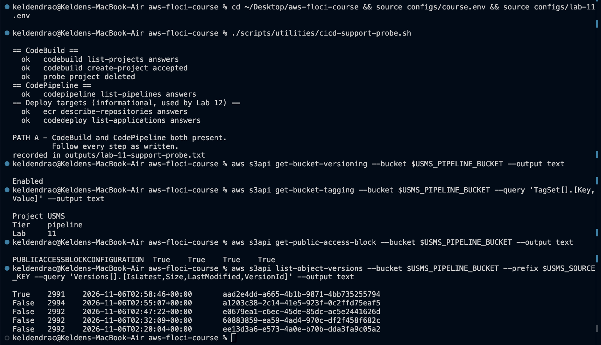
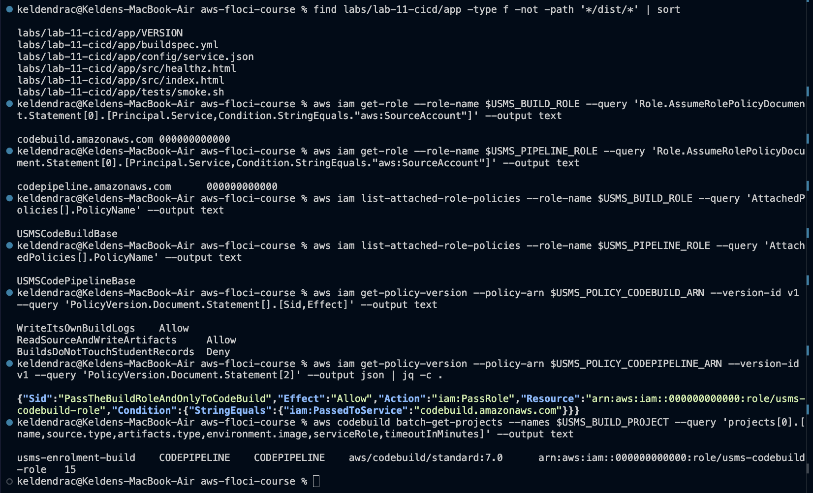
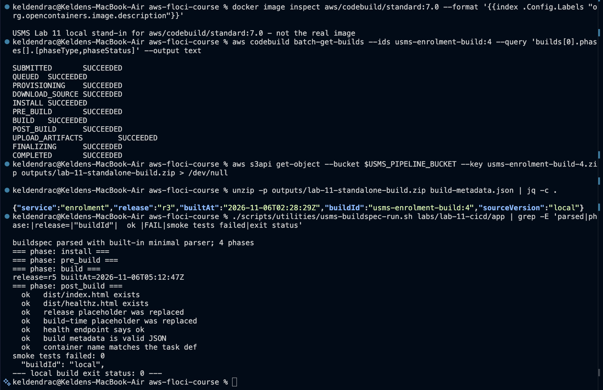
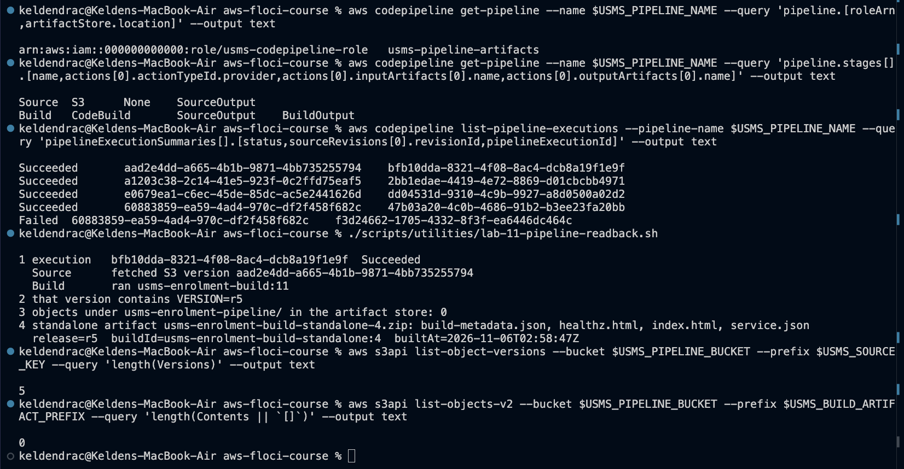
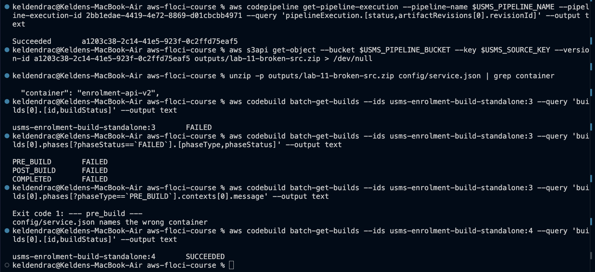
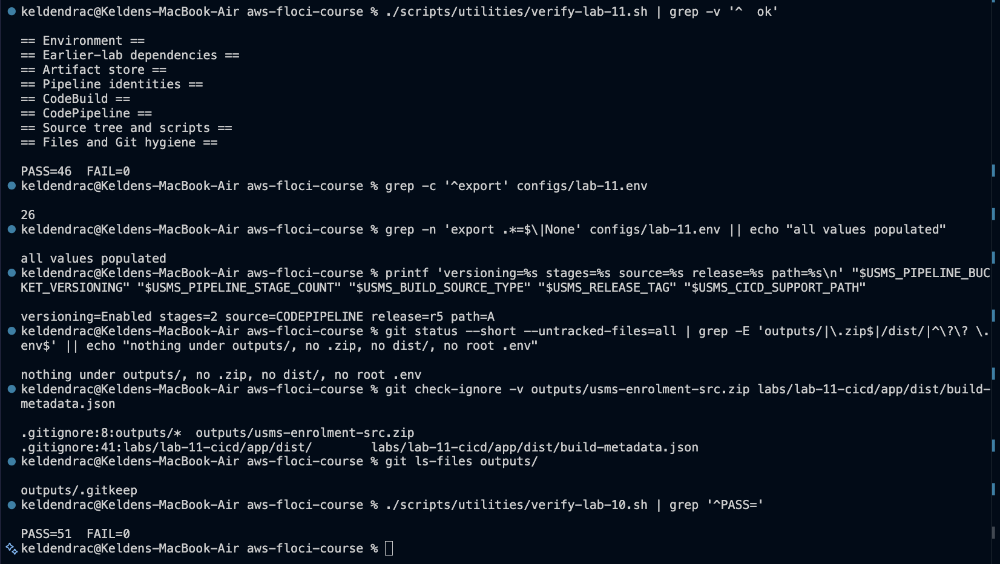

# Lab 11 - Building a CI/CD pipeline with CodePipeline and CodeBuild - completed

Full write-up: [lab-11-report.md](lab-11-report.md) - exercises: [exercises.md](exercises.md) - notes and review questions: [../../notes/lab-11-notes.md](../../notes/lab-11-notes.md)

**Support path: A by the probe, mixed in practice, on Floci 2.2.0.**
- **CodeBuild really runs builds** in Docker containers, once a local stand-in image is
  tagged `aws/codebuild/standard:7.0`.
- **The pipeline does not run its build.** It executes both stages and records the exact S3
  version it fetched, but its build receives an empty source directory and no artifacts are
  stored. So it is green even on broken source.
- **What stands in.** The proof that the pipeline consumed a release is rebuilt from the
  version it recorded, plus a real CodeBuild build of the same key by
  `usms-enrolment-build-standalone`.

## What exists after this lab

- **Artifact store** `usms-pipeline-artifacts`:
  - versioned, public access blocked, EventBridge notifications on
  - `source/usms-enrolment-src.zip` with 9 versions (r3 to r6)
- **Source tree** `labs/lab-11-cicd/app/`:
  - `buildspec.yml`: four phases; `pre_build` parses `service.json`; `build` writes
    `imagedefinitions.json`; `post_build` has a `finally`
  - `VERSION` r6
  - `tests/smoke.sh` with 8 assertions
- **Identities:**
  - `usms-codebuild-role` + `USMSCodeBuildBase`; trust conditioned on account and three
    project ARNs
  - `usms-codepipeline-role` + `USMSCodePipelineBase`; PassRole on one role, to CodeBuild
    only
  - `usms-pipeline-trigger-role` + `USMSPipelineTriggerBase` (Exercise 4)
- **CodeBuild:**
  - `usms-enrolment-build`, with source `CODEPIPELINE`
  - `usms-enrolment-build-standalone`, the Floci stand-in with an S3 source
  - `usms-results-build` (Exercise 1)
- **CodePipeline:** `usms-enrolment-pipeline`, Source (S3) to Build (CodeBuild)
- **EventBridge:** `usms-enrolment-src-change-s3` (enabled) and `-cloudtrail` (disabled),
  both targeting the pipeline
- **Local Docker image:** `aws/codebuild/standard:7.0`, from
  `labs/lab-11-cicd/codebuild-standin/Dockerfile`
- **Config:** `configs/lab-11.env` (26 exports); `.gitignore` ignores
  `labs/lab-11-cicd/app/dist/`
- **Scripts** (cleanup never run):
  - `scripts/utilities/`: `cicd-support-probe.sh`, `usms-pack-source.sh`,
    `usms-buildspec-run.sh`, `write-lab-11-templates.sh`, `usms-wait-build.sh`,
    `lab-11-pipeline-readback.sh`, `write-lab-11-env.sh`, `verify-lab-11.sh`,
    `lab-11-readiness.sh`
  - `scripts/cleanup/lab-11-cleanup.sh`

## Reproduce

    cd ~/Desktop/aws-floci-course
    ./scripts/setup/floci-up.sh
    docker build -t aws/codebuild/standard:7.0 labs/lab-11-cicd/codebuild-standin
    source configs/course.env
    source configs/lab-11.env
    ./scripts/utilities/verify-lab-11.sh

Expected: `PASS=46  FAIL=0`. Read it with the report's Section 3.7: the script checks
configuration, so it passes even though the pipeline's builds build nothing on this Floci
build.

## Evidence

### 1. Checkpoints 1-2 - probe and artifact store

### 2. Checkpoints 3-4 - source tree, identities, project

### 3. Checkpoints 5-6 - a real build and the local runner

### 4. Checkpoints 7-8 - the pipeline and what it consumed

### 5. Checkpoint 9 - a deliberate failure, diagnosed

### 6. verify-lab-11.sh and hygiene

## Problems I hit and how I fixed them

### 1. Every build ended FAULT

Floci pulls `aws/codebuild/standard:7.0` from Docker Hub, where it does not exist. A
labelled local stand-in under that name (`FROM python:3.12-slim`) keeps the project document
exactly as real AWS would accept it.

### 2. Builds that "succeeded" without building

- **On an S3 source,** Floci reads the project's `"buildspec": "buildspec.yml"` as inline
  YAML, so nothing runs. The template omits the field, which means the same on AWS.
- **In the pipeline,** the build gets an empty source directory and no artifacts are
  stored. So the pipeline went green on deliberately broken source, and only the
  standalone twin's `PRE_BUILD` caught it.

### 3. Not demonstrable on this build

- **`finally`:** never runs. I extended the local runner to test it instead.
- **EventBridge starting the pipeline:** the target type is unsupported, though the S3
  event and the one-key match were captured.
- **Build logs:** empty.
- **`CODEBUILD_RESOLVED_SOURCE_VERSION`:** not set.

### 4. Two guide checks that would mislead

- **`grep '"port": 80'`** matches `8080`.
- **"No secret is tracked"** fails on the deliberately tracked `outputs/.gitkeep`.

Both are fixed and commented.

### 5. Handed to Lab 12

`outputs/lab-11-lab08b-readiness.txt` records the `imagedefinitions.json` contract. It also
records that on Floci 2.2.0 a Deploy stage will find no stored `BuildOutput`, and that the
stand-in image has no `docker` CLI.
