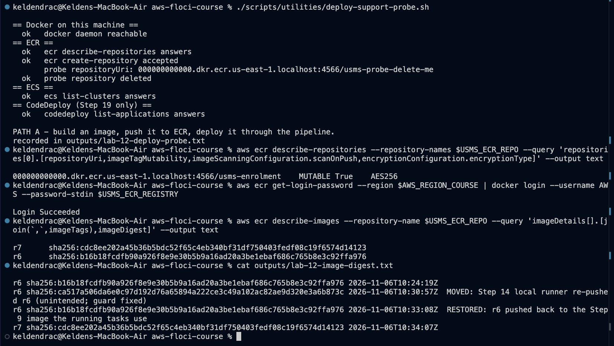
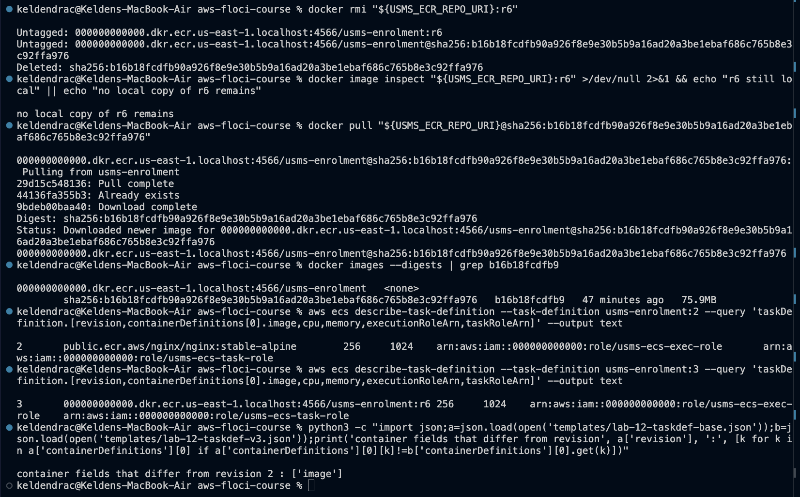
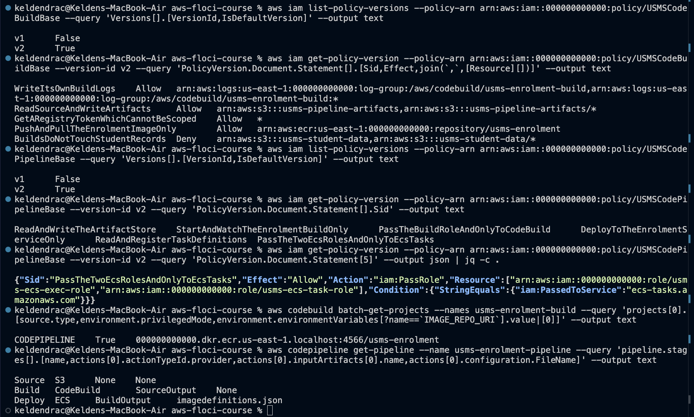
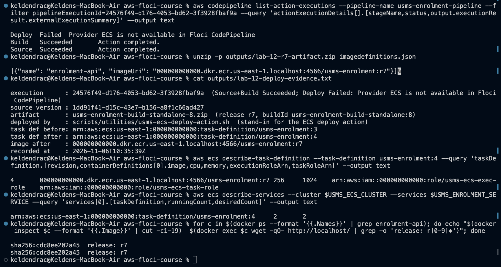
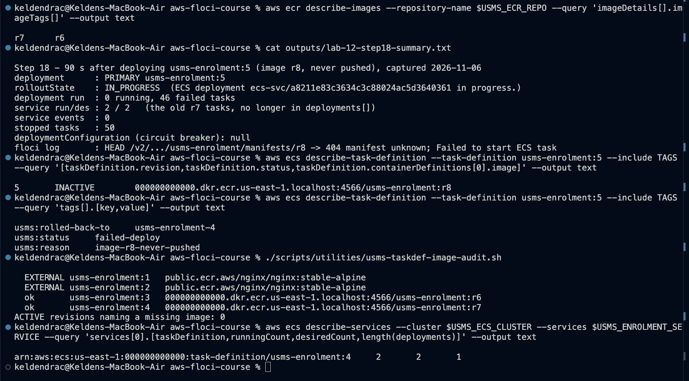
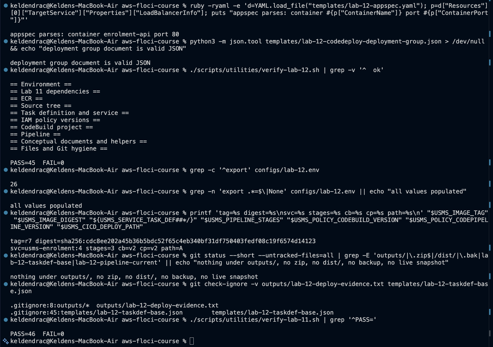

# Lab 12 - Deploying to Amazon ECS from the Pipeline - completed

Full write-up: [lab-12-report.md](lab-12-report.md) - exercises: [exercises.md](exercises.md) - notes and review questions: [../../notes/lab-12-notes.md](../../notes/lab-12-notes.md)

**Support path: A by the probe, mixed in practice, on Floci 2.2.0.**
- **What is real:** ECR push and pull, tag immutability, and ECS tasks. The service's
  containers really run our image and serve `release: r7`.
- **What fails:** the pipeline's Deploy stage, with `Provider ECS is not available in Floci
  CodePipeline`.
- **What stands in:** a labelled stand-in, `usms-ecs-deploy-action.sh`, performs that action's
  four steps from a real CodeBuild artifact. The pipeline document itself has three stages.

## What exists after this lab

- **ECR** `usms-enrolment` (`MUTABLE`, scanOnPush, AES256):
  - `r6` `sha256:b16b18fc...`
  - `r7` `sha256:cdc8ee20...`
  - `r7-alt` (Exercise 1)
- **ECS** family `usms-enrolment`:
  - `:3` r6 (derived by describe-strip-register)
  - `:4` r7 (stand-in deploy)
  - `:5` r8, never pushed: tagged with the reason and `INACTIVE`

  The service runs `:4`, 2/2.
- **IAM:**
  - `USMSCodeBuildBase` v2 (ECR push) and `USMSCodePipelineBase` v2 (one service, a second
    scoped `PassRole`), both default
  - `usms-codepipeline-role` trust conditioned on the pipeline's ARN (Exercise 4)
- **CodeBuild / CodePipeline:**
  - `privilegedMode` and `IMAGE_REPO_URI` on the project
  - pipeline Source to Build to Deploy (ECS, `imagedefinitions.json`)
- **ELB** (Exercise 3): `usms-enrolment-tg-green` and a test listener on 8080
- **Source tree:**
  - `Dockerfile` (`BASE_IMAGE` argument) and `.dockerignore`
  - `buildspec.yml` extended (guarded image build, collision-free tag, `imagedefinitions.json`);
    the Lab 11 version kept as `buildspec.yml.lab08a`
- **Config:** `configs/lab-12.env` (26 exports)
- **Scripts** (cleanup never run):
  - `scripts/utilities/`: `deploy-support-probe.sh`, `usms-ecs-watch.sh`,
    `lab-12-derive-taskdef.sh`, `write-lab-12-templates.sh`, `usms-ecs-deploy-action.sh`,
    `usms-taskdef-image-audit.sh`, `write-lab-12-env.sh`, `verify-lab-12.sh`,
    `lab-12-fill-deployment-group.sh`, `lab-12-pipeline-role-simulate.sh`,
    `lab-12-release-evidence.sh`
  - `scripts/cleanup/lab-12-cleanup.sh`

## Reproduce

    cd ~/Desktop/aws-floci-course
    ./scripts/setup/floci-up.sh
    source configs/course.env
    source configs/lab-04.env
    source configs/lab-12.env
    ./scripts/utilities/verify-lab-12.sh

Expected: `PASS=45  FAIL=0`. If `docker login` returns 503, the registry sidecar has lost Floci's
network: `docker network connect floci-course_default floci-aws-floci-course-ecr-registry`.

## Evidence

### 1. Checkpoints 1-2 - probe, repository, login

### 2. Checkpoints 3-4 - pulled back by digest; revision 3

### 3. Checkpoints 5-7 - policies, project, pipeline

### 4. Checkpoint 8 - release r7

### 5. Checkpoint 9 - the rollback drill

### 6. verify-lab-12.sh and hygiene

## Problems I hit and how I fixed them

### 1. Step 4 stopped Floci

**The cause.** Floci's ECR registry is a sidecar that already publishes `127.0.0.1:5100`, so
publishing the range again failed with "port is already allocated".

**The fix.** I left the line commented, with the reason beside it. Pushes go through port 4566.

### 2. `docker login` returned 503

**The cause.** After the recreate, Floci and the registry sidecar shared no Docker network.

**The fix.** `docker network connect floci-course_default floci-aws-floci-course-ecr-registry`.

### 3. The pipeline cannot deploy on this build

`Provider ECS is not available in Floci CodePipeline`. The stand-in deploy action is labelled as
such in every file that mentions it.

### 4. `r6` moved twice

- **The guard.** The guide's `docker info` guard made the local runner re-push `r6`. The guard
  now requires CodeBuild.
- **zsh.** It turned `"$ECR_URI:r6"` into a stray repository, through the `:r` modifier. All
  commands now use `${...}`.

The digest ledger records the move and the restore.

### 5. No circuit breaker, and an endless retry

This repository's Lab 04 never set a circuit breaker. On Floci an unpullable image fails tasks
for ever, with no events. I rolled back by hand, and tagged and deregistered `:5`. A new audit
finds such revisions.

### 6. Three guide checks or steps that needed adapting

- **`verify-lab-11.sh`'s "exactly 2 stages":** Lab 12 adds a third.
- **The family-name lookup:** Floci returns a deregistered revision for it.
- **Step 14's wholesale buildspec rewrite:** it would have deleted Lab 11's exercise work.
