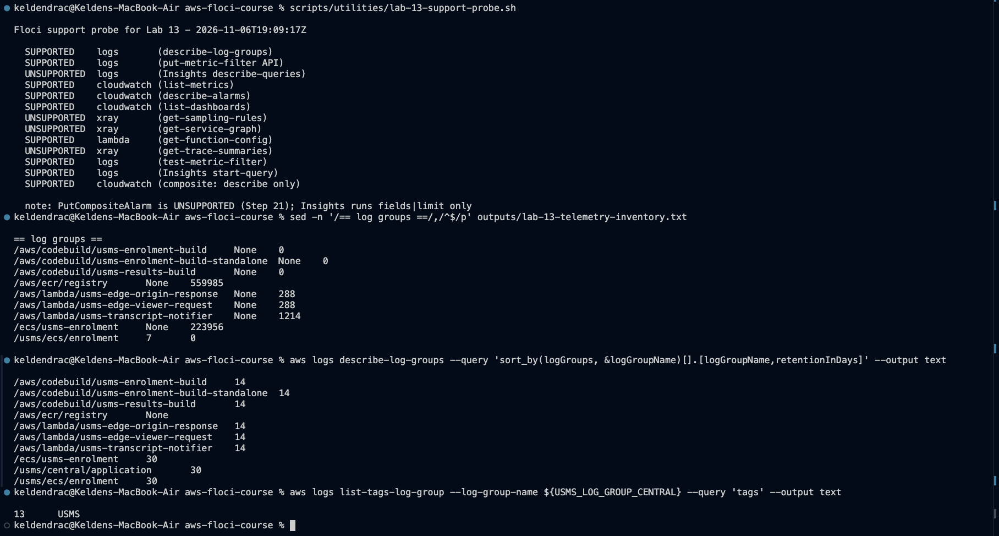
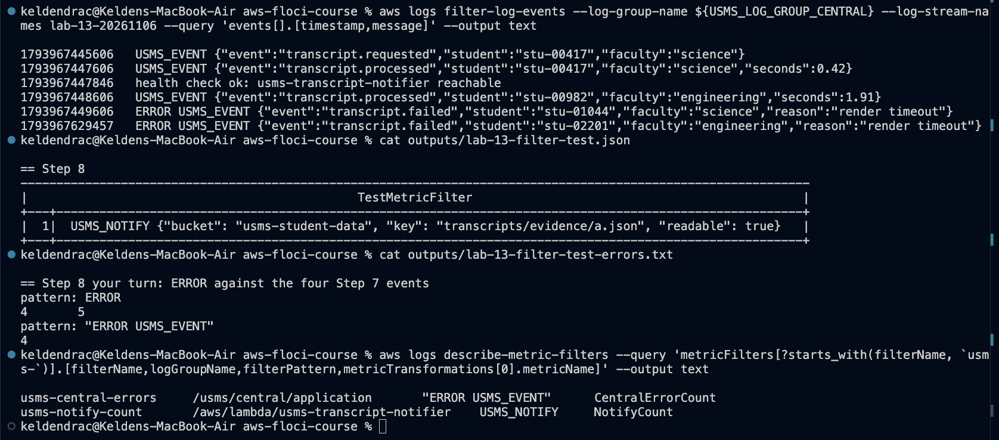
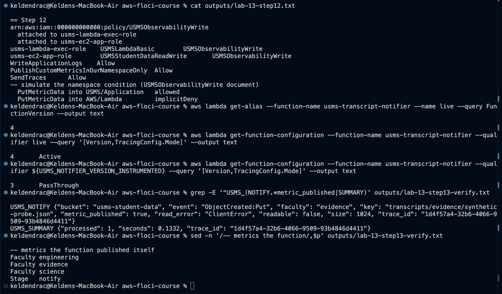
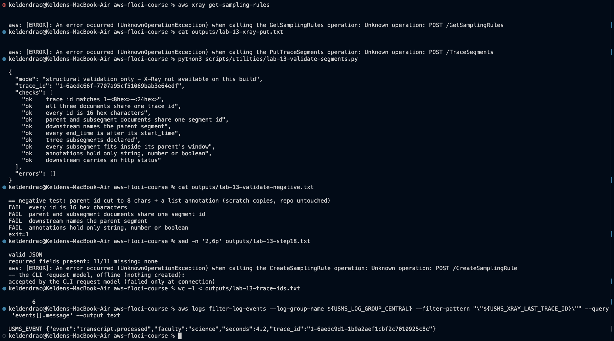
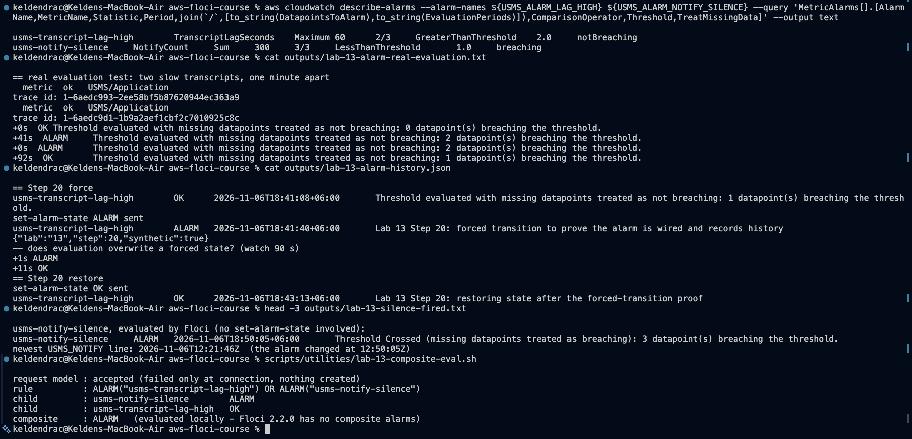
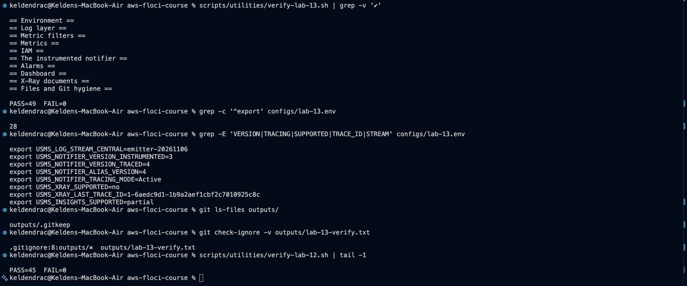

# Lab 13 - Centralized Logging and Monitoring with CloudWatch and X-Ray - completed

Full write-up: [lab-13-report.md](lab-13-report.md) - exercises: [exercises.md](exercises.md) - notes and review questions: [../../notes/lab-13-notes.md](../../notes/lab-13-notes.md) - Exercise 4: [../../notes/lab-13-observability-plan.md](../../notes/lab-13-observability-plan.md) - Project Checkpoint 1: [../../project/checkpoint-01/](../../project/checkpoint-01/architecture.md)

**Support path: mixed, on Floci 2.2.0.**
- **What is real, and more than the guide expects:**
  - logs, retention and tags
  - metric filters, **evaluated on ingestion**
  - custom metrics
  - alarms, **really evaluated**: a real breach went to `ALARM` and back, a forced state was
    reverted in about 11 s, and the silence alarm fired by itself
  - dashboards (stored and validated)
- **What is absent:**
  - X-Ray: every call is `UnknownOperationException`
  - `PutCompositeAlarm` and `describe-alarm-history`
  - Logs Insights beyond `fields | limit`
- **What stands in:**
  - a structural validator for the trace documents
  - the composite alarm as a committed request document, evaluated against the live child states
  - local aggregation for Step 23

## What exists after this lab

- **Logs:**
  - `/usms/central/application`: 30 days, tagged `Project=USMS`, `Lab=13`
  - every other USMS group on 30 days (application) or 14 days (function and build)
- **Metric filters:**
  - `usms-notify-count`: `USMS_NOTIFY` to `NotifyCount`
  - `usms-central-errors`: `"ERROR USMS_EVENT"` to `CentralErrorCount`
  - `usms-transcript-seconds`: extracts `$seconds` (Exercise 1)
- **Metrics** (`USMS/Application`):
  - `NotifyCount`, `CentralErrorCount`, `TranscriptsProcessed` (with and without dimensions),
    `TranscriptLagSeconds`, `EdgeDenyCount`
  - `TranscriptSecondsFromLogs` (Exercise 1)
- **IAM:** `USMSObservabilityWrite`, on `usms-lambda-exec-role` and `usms-ec2-app-role`, with
  `PutMetricData` limited to the namespace.
- **The notifier:**
  - version 3: instrumented, PassThrough
  - version 4: `Active`
  - `live` on 4 (the guide's "v2" and "v3": Lab 10 had already made a 2)
- **Alarms** (no actions):
  - `usms-transcript-lag-high` (`notBreaching`)
  - `usms-notify-silence` (`breaching`)
  - the composite `usms-transcript-pipeline-down`, as `templates/lab-13-composite-alarm.json`
- **Dashboard:** `usms-overview`, 6 widgets, generated by `write-lab-13-dashboard.sh`.
- **Traces:** three segment documents and a sampling rule, in `templates/`.
- **Config:** `configs/lab-13.env` (28 exports).
- **Scripts** (cleanup never run):
  - `scripts/utilities/`: `lab-13-support-probe.sh`, `lab-13-telemetry-inventory.sh`,
    `usms-emit-telemetry.sh`, `lab-13-validate-segments.py`, `lab-13-alarm-states.sh`,
    `lab-13-composite-eval.sh`, `lab-13-faculty-counts.sh`, `lab-13-restart-facts.sh`,
    `write-lab-13-env.sh`, `verify-lab-13.sh`, `lab-13-ex1-seconds-filter.sh`,
    `write-lab-13-dashboard.sh`, `usms-threshold-report.sh`, `lab-13-alerting-readiness.sh`,
    `usms-project-inventory.sh`, `usms-end-to-end-demo.sh`
  - `scripts/cleanup/lab-13-cleanup.sh`
- **Project Checkpoint 1:** `project/checkpoint-01/` (architecture, gaps, demo, inventory,
  evidence).

## Reproduce

    cd ~/Desktop/aws-floci-course
    ./scripts/setup/floci-up.sh
    source configs/course.env
    source configs/lab-01.env
    source configs/lab-13.env
    ./scripts/utilities/verify-lab-13.sh

Expected: `PASS=49  FAIL=0`. `usms-notify-silence` reads `ALARM` after any 15 minutes without a
notification. That is the alarm working; an upload to `transcripts/evidence/` returns it to `OK`.

## Evidence

### 1. Checkpoints 1-2 - probe, inventory, retention

### 2. Checkpoints 3-4 - events and filters

### 3. Checkpoints 5-6 - metrics

![NotifyCount empty before the upload, Sum 2 from 4 samples with it; metrics by dimension set; lag statistics; [] with no dimensions; CentralErrorCount read back](../../screenshots/lab13-03-checkpoints5-6-metrics.png)

### 4. Checkpoints 7-8 - IAM and the notifier

### 5. Checkpoints 9-10 - traces

### 6. Checkpoint 11 - alarms

### 7. Checkpoints 12-13 - dashboard, queries, restart

![5 widgets, validation []; Insights runs fields|limit only; faculty counts by path B; identical inventories across the restart; 3 data points before and after](../../screenshots/lab13-07-checkpoints12-13-dashboard-queries-restart.png)

### 8. verify-lab-13.sh and hygiene

## Problems I hit and how I fixed them

### 1. The `--log-events` shorthand rejected every structured line

`ParamValidation`, before anything was sent: the shorthand parser reads the JSON's quotes and
commas as its own syntax. Every `USMS_EVENT` line now goes as JSON through `file://`.

### 2. The guide expects alarms that never evaluate

Here they do, so two of the guide's ideas needed changing:
- **"No alarm left in `ALARM`"** now means "no alarm left in a state the lab **forced**". The
  silence alarm in `ALARM` after a quiet spell is correct.
- **The restart inventory** compares alarm **configuration**, not states.

### 3. No X-Ray, no composite alarms, partial Insights

Each has a labelled stand-in, and each check that depends on one says so. The composite is a
committed request document that the CLI's request model accepts. A script evaluates its rule
against the real child states.

### 4. A bug in the guide's verify script

`Metrics[].join(...) || \`NONE\`` applies `||` to the whole list, so "published without
dimensions" could never pass. A per-element multiselect fixes it. This was the first run's one
failure (`48/1`).

### 5. Misleading probe labels, and an empty evidence file

Both were found in the screenshots:
- **The probe.** It labelled a `describe-queries` call "Insights start-query", and a read-only
  composite probe "SUPPORTED". It now names each call; screenshot 01 was retaken.
- **The negative-test file.** It was empty. The test was re-run on scratch copies of the
  templates.

### 6. Exercise 1 needed the emitter's line to change

A compact JSON body behind a `USMS_EVENT ` prefix is unreadable to both filter dialects. The
seconds are now repeated as a trailing token. One reader that used a strict `json.loads` was
fixed to stop at the end of the object.
