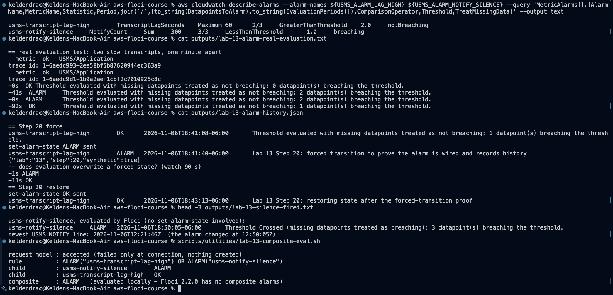
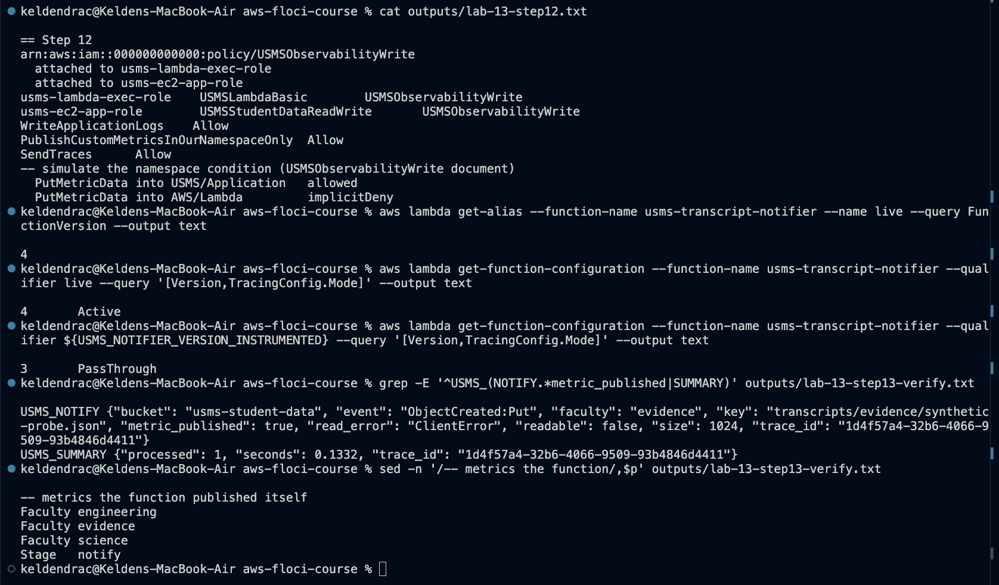
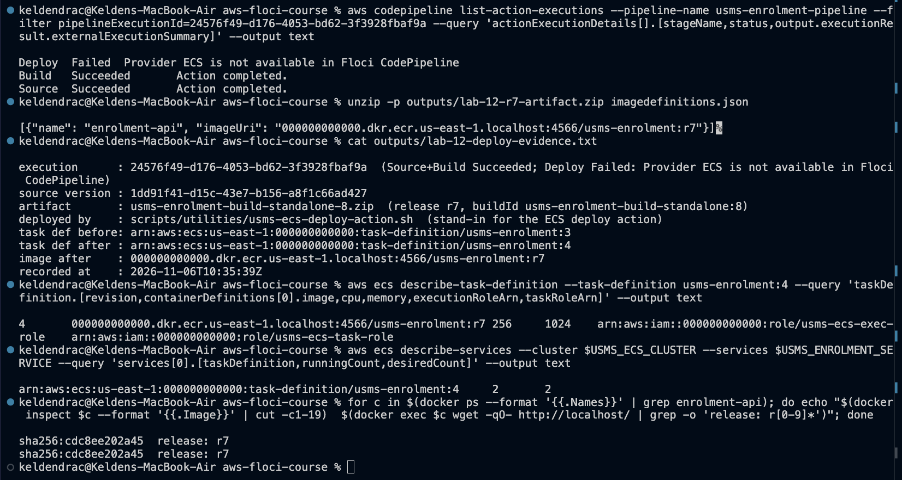
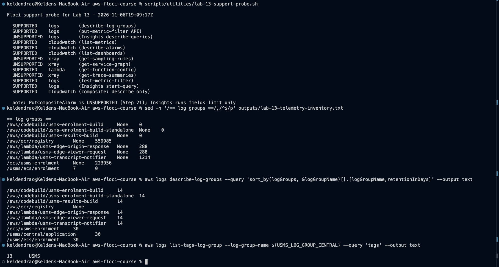
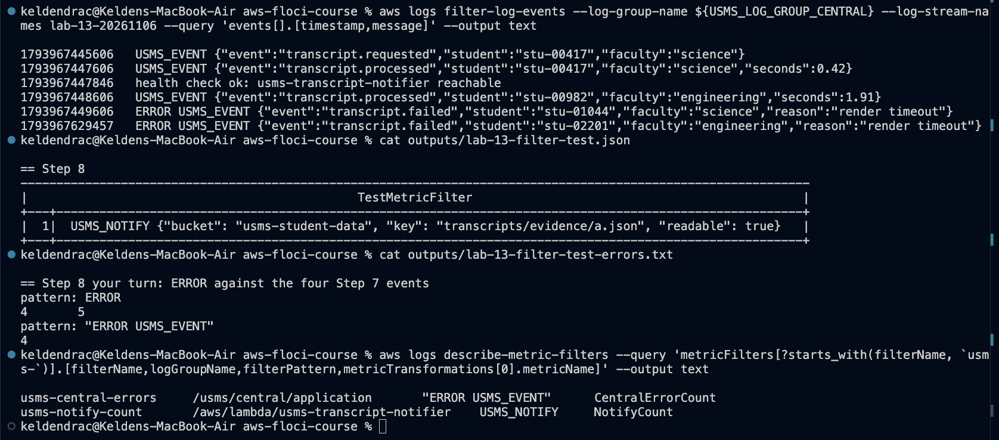
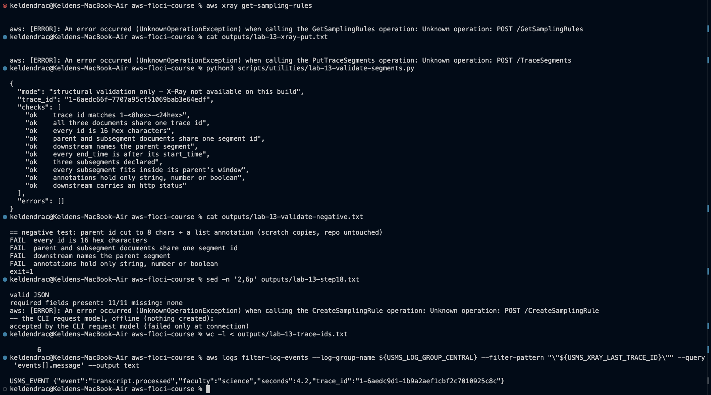
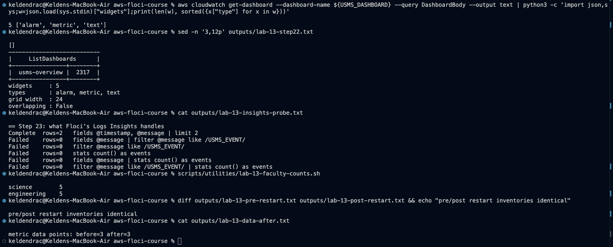
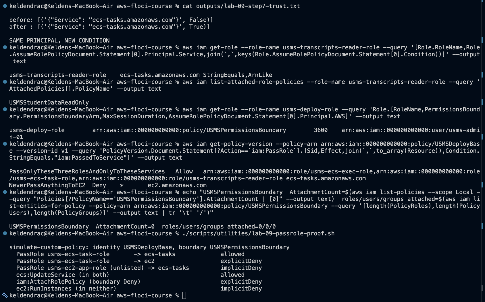

# USMS - the 8-minute demonstration

One path, live, then the evidence that the rest exists. Everything shown is re-runnable from the
repository; nothing is typed from memory.

**Before the session:**
- Start Floci: `./scripts/setup/floci-up.sh`
- Source the environment: `source configs/course.env` and `source configs/lab-13.env`
- Have `project/checkpoint-01/evidence/end-to-end.txt` open, as the fallback if anything live
  stalls

| Time | Show | Say |
|---|---|---|
| 0:00-0:45 | [architecture.md](architecture.md), Section 1 | USMS is one system: identity, network, three generations of compute, a bucket with a function behind it, a delivery pipeline, and an observability layer over all of it. I will follow one transcript through it |
| 0:45-3:30 | `./scripts/utilities/usms-end-to-end-demo.sh`, live, in about 40 seconds | Stages 1-4: who I am, the bucket, its notification to `notifier:live`, and `live` = version 4 with tracing `Active`. Stage 5b is the real one: an upload, then the notifier's own `USMS_NOTIFY` line naming that key, read back from its log group |
| 3:30-4:30 | Stages 6-9 of the same output | The event in the central log, the metrics, the two alarms with **opposite** missing-data policies, the composite rule evaluated against them, and the six-widget dashboard |
| 4:30-5:30 |  | On this emulator the alarms really evaluate. Two slow transcripts put `lag-high` into ALARM after 41 s. A forced ALARM was reverted within 11 s. The silence alarm fired on its own during a quiet spell, which is the failure a value threshold cannot see |
| 5:30-6:15 |  | A version freezes configuration as well as code. That is why rollback is one alias update, and why the tracing change needed its own version |
| 6:15-7:00 |  | Where Floci cannot run a step, a stand-in says so in its name. Here the image really runs: both containers serve `r7` |
| 7:00-7:45 | [inventory.txt](inventory.txt), the `== verification ==` block | Thirteen verification scripts. Every FAIL is explained in [gaps.md](gaps.md), section 1; none is new |
| 7:45-8:00 | [gaps.md](gaps.md), section 3 | The next things to build: alarm actions, a delivery-ratio alarm so the silence alarm stops being the pager, and an audit trail for downloads |

## If something goes wrong live

- **Stage 5b prints "did not fire within 60 s".** Show `evidence/end-to-end.txt`, where it did.
  Then check that the notifier's Lambda container can reach Floci: `docker-compose.yml` needs the
  two `FLOCI_SERVICES_LAMBDA_*` settings from Lab 10.
- **`docker login` or ECR answers 503.** This is not part of the demonstration. Run
  `docker network connect floci-course_default floci-aws-floci-course-ecr-registry` afterwards.
- **An alarm shows a different state from the screenshot.** That is expected, because the alarms
  are evaluated continuously. `usms-notify-silence` is `ALARM` after any 15 quiet minutes and
  returns to `OK` after notifications resume. Say so; it is the point of the alarm.

## The remaining evidence, if asked

| Question | Where |
|---|---|
| "Show me the retention you set" |  |
| "How do you know the metric filter works?" |  and [the Lab 13 exercises](../../labs/lab-13-cloudwatch-xray/exercises.md), Exercise 1 |
| "Where are the traces?" |  |
| "Does it survive a restart?" |  |
| "Is the IAM design sound?" |  |
